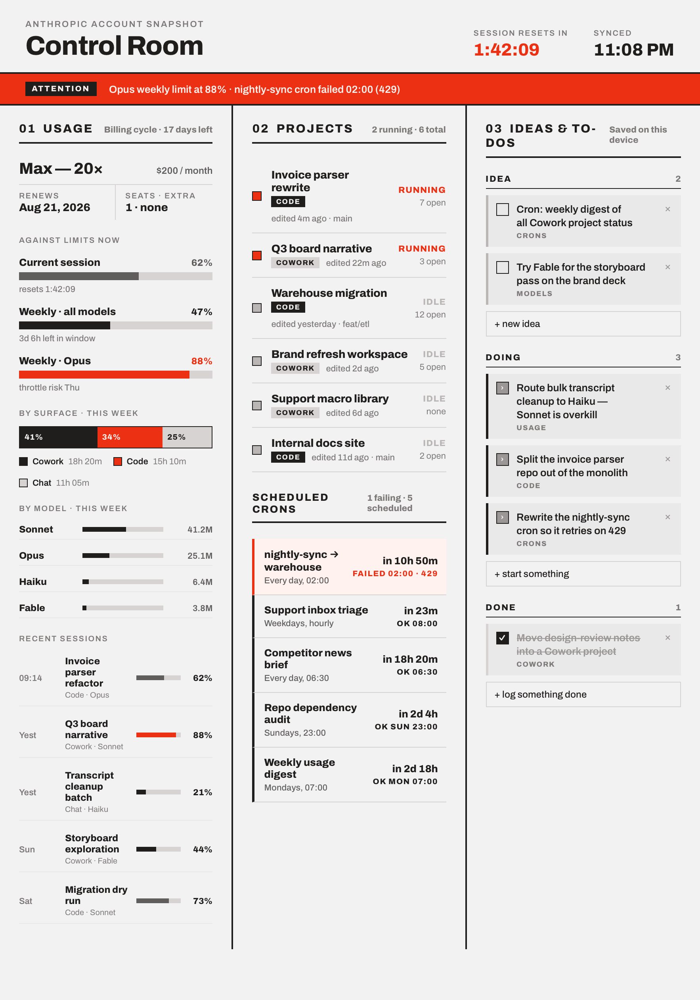

# Claude Control Room

A single-screen operational dashboard for one person's Claude account: spend against
limits, running projects and scheduled crons, and a personal backlog. Three equal
columns, built to be read at a glance from a desk browser and an iPad. It runs as a
background service on an always-on Mac and shows real data pulled from the local
machine — nothing is faked, and anything that has no real source says so.



*(This is the design reference the UI was built to match pixel-for-pixel — see
[Fragility](#fragility) for why a live screenshot isn't checked in.)*

**This is a personal tool for one machine and one account.** The source is public so it
can be read, learned from, and adapted, but it is not a product: it targets one person's
file layout, one person's home directory, and CLI output that Anthropic does not
document or version. See [Adapting it](#adapting-it) before assuming it will run
anywhere else unmodified.

## What it shows, and where the numbers come from

Every panel is wrapped in a status of `ok`, `stale`, or `unavailable`. A `stale` panel
shows the last good data with a visible marker instead of silently going quiet, and an
`unavailable` panel shows its frame and heading with an explicit no-source state —
never a zero or an empty bar standing in for missing data.

| Panel | Source | Reality |
|---|---|---|
| Header countdown | `claude -p "/usage"` reset timestamp | Real |
| Plan block — tier | `claude auth status --json` (`subscriptionType`) | Real, but coarse and can lag a plan change by days — see below |
| Plan block — price, renews, seats | `config.json` | Static — no API exposes pricing, renewal date, or seat count |
| Credits (included, promotional and cloud-session grants; usage-credit balance) | The CLI's cached usage response in `~/.claude.json` (`cachedUsageUtilization`), refreshed by every `/usage` poll; falls back to the `/api/ingest/credits` feed, then `config.json`, only when that cache cannot be read | Real, read automatically every minute. Undocumented cache with codenamed buckets — see below |
| Three limit bars (session, weekly all-models, weekly per-model) | `claude -p "/usage"` | Real |
| By surface · this week (Cowork / Code / Chat) | Session-log token sums under both transcript roots | Real for Cowork and Code; **Chat is permanently unmeasurable** — see below |
| By project · this week | Same transcript roots, top 3 by tokens + Other | Real |
| By model · this week | Same transcript roots | Real |
| Recent sessions | Same transcript roots; percent = that session's share of the week's tokens | Real |
| Pace tick + projection on each limit bar | `/usage` history (see below) plus an observed window length | Real, but the session bar has no fallback — see below |
| Sparklines on each limit bar | Same history store | Real; needs at least two readings, else says so |
| Usage drivers panel | `/usage`'s contributing-factors block | Real, but **local-machine-only and approximate** — unlike every account-wide percentage above it in the same column, see below |
| Projects (column 02) | Cowork session metadata + transcript logs + git branch | Real; no running/idle state since 2026-10-30 (the `claude agents --json` poll was dropped, see [How often the server starts `claude`](#how-often-the-server-starts-claude)) |
| Scheduled crons | `~/Library/LaunchAgents/*.plist` + `launchctl list`, plus `/api/ingest/crons` for anything that reports in from elsewhere | Real |
| Ideas & to-dos (column 03) | `server/todos.json`, read and written through the server | Real, but local state, not derived from any external source. Below 1024px wide it is the second column on screen, after Usage and ahead of Projects. Each item carries a stage, a free-text tag and an optional `P0`–`P3` priority; the column groups by stage or by tag and sorts by priority within each group, unset last. An item can carry an optional due date, shown as a chip on its card (red once it has passed, unless the item is done), and a per-viewer "Sort by Due" switch puts dated items first, soonest first (see "The board's items" below). Tags are printed uppercase, so the server unifies tags that differ only by case on every write (majority casing wins) rather than letting `Pi` and `pi` fork invisibly |

**Chat (claude.ai) is not a temporary gap — it has no local source and never will.**
Conversations there are server-side; the client never computes or exposes
per-conversation token usage anywhere on disk. The UI renders the Chat segment
explicitly labeled "not measurable locally" rather than omitting it or showing zero.

**The token figures count each API request once, in new tokens.** By surface, by
project, by model and recent sessions all add up `input + output + cache creation`
per API request, from each transcript line's `message.usage`. Cache reads are left
out: they re-serve the same context on every request and are over 95% of the raw sum
(the server keeps them as `cacheReadTokens`, but no panel prints them). Claude Code
writes one response as several lines, one per content block (thinking, text, each tool
call), and every line repeats the response's usage, so `server/lib/parse-transcript.mjs`
merges the lines that share a `requestId` and message id. It keeps each usage field's
largest reading (a line written mid-stream can carry a smaller output count) and the
first line's time and model; a line that lacks either id counts on its own. A forked
subagent's transcript opens with a copy of the parent's line that launched it, so the
sessions collector also counts a request found in two files once, in the earlier copy.
Until 2026-10-20 the lines were summed one by one, and the week read 3x too high:
149.7M new tokens instead of 49.9M.

**Transcripts are read as a stream, and only when they change.** The sessions
collector reads each transcript a line at a time (`parseTranscriptFile` in
`server/lib/parse-transcript.mjs`), never as one string. Node can't hold a string
longer than about 512 MiB, and a long-running session's transcript gets there within
a week: Jarvis's was 145 MB after 31 hours on 2026-10-20. Read whole, that file would
have failed and dropped his session out of every total. The server also keeps each
file's result between passes and reads a file again only when its size, mtime or
inode changes, so a pass costs about a tenth of a second when little has changed.
Measured 2026-10-20 on the real transcripts: a first pass took 2.1 s with a 276 MB
peak, where the old whole-file reads took 3.4 s and peaked at 1.55 GB. A line too long
to decode is skipped and the file is listed as not fully read. Its other lines still
count.

**Credits are read, not typed.** Every `claude -p "/usage"` — which the usage collector
already runs every five minutes — refreshes `cachedUsageUtilization` in `~/.claude.json`
with the account's full usage response, including every dollar-denominated credit
bucket. `server/lib/account-credits.mjs` treats any bucket with a dollar limit as a
grant and shows what is left and when it expires. The bucket names are internal
codenames, so only ones verified against claude.ai's usage page get a real label
(`Cloud session credits`, `Promotional credit`); an unrecognised one is still shown,
as `Included credit`, rather than hidden or guessed at. A cache older than 30 minutes is
refused, so a dead poll marks the panel stale instead of passing an old balance off as
current. Only the parsed figures leave the collector — the account id and everything
else in that file are discarded at the parse boundary. While this source is readable,
hand-entered `config.json` credits are neither shown nor alerted on.

**Project task counts are not shown.** No source (agents JSON, session logs, or
anything else on this machine) reliably gives an open-task count per project, so that
field is `null` end-to-end and the UI simply doesn't print the line — it does not
invent a number.

## Pace, history, and the usage-drivers panel

### Why there's a history store at all

The transcript-backed panels this dashboard shows can be recomputed after the
fact — token counts, project activity, and session lists all live on disk in
transcripts that aren't going anywhere. The `/usage` percentages are different: they are a
point-in-time reading with no record behind them. Miss a poll, or don't capture
the number the moment it's printed, and that moment is gone permanently — there is
no transcript to recompute it from later. That's the entire reason
`server/history.mjs` exists: it appends every successful `/usage` reading to
`server/data/usage-history-YYYY-MM.jsonl` (gitignored — this is runtime data, not
source) so the dashboard can show a trend instead of only a snapshot.

The store is append-only and month-rotated, one record per **successful** poll —
a failed, stale, or absent reading writes nothing, so a gap in the file always
means "no reading," never "a reading of zero." Retention is indefinite (the data
is non-recoverable and the volume is trivial — roughly 21 MB a year at one
reading every five minutes), while the server keeps the most recent 30 days in
memory to serve sparklines. That 30 days is a **single constant**,
`RETENTION_MS` in `server/history.mjs`: `server.mjs` asks the store for exactly
that span and `lib/usage-panel.mjs` caps a sparkline's range to it, so widening
retention actually widens the series instead of silently doing nothing. At startup it warms that window by loading enough
trailing month files to cover the configured retention, not a fixed count — a
walk-back derived from retention rather than fixed to two months, precisely so a
longer retention setting doesn't silently lose its oldest data. At the default
30-day retention that currently means three month files (the current month plus
the two before it). A corrupt line is skipped on read, the same tolerance the
transcript parser already has — the store never seeds, fabricates, or rewrites a
file to "repair" it.

### Pace: the session window length is observed, not assumed

`/usage` tells you when a limit's window *ends* but never how long that window
*is*. Weekly windows can fall back to a plausible default because the label
itself says "Current week" — seven days. **The session window has no such
label and gets no fallback.** Instead, the dashboard watches the history for a
window rolling over and reads the length off the jump.

A forward jump is **not** automatically one window length, and treating it as
one produced real, wrong numbers on this dashboard. Session windows are
user-initiated, so they aren't contiguous: after an idle spell the next window
starts when you send the next message, and the jump spans *idle + window*. The
printed reset also flaps by a minute between polls (`07:49` / `07:50` both
appear in captured history), so a rollover first caught on the low side
"recovers" into a one-minute jump. `server/lib/pace.mjs` therefore accepts a
jump as evidence only when all of these hold:

- **We saw it happen.** The jump must be first seen within
  `MAX_ROLLOVER_LATENESS_MS` (15 minutes, three poll intervals) of the reset it
  supersedes. This is not a confidence heuristic: since the new window began at
  or after the old reset and had certainly begun by the time we saw its new
  reset, the lateness of that sighting is an *exact upper bound* on how much of
  the jump could be idle — so a punctual sighting is an accurate measurement,
  and a late one measures nothing. The bound is two-sided — a sighting up to
  15 minutes *before* the old reset is accepted too, since the CLI prints resets
  rounded to the minute and a poll can land seconds ahead of a reset that has in
  fact rolled; anything further out on either side is refused.
- **It is a plausible window.** Anything under `MIN_PLAUSIBLE_WINDOW_MS`
  (30 minutes) is rejected outright — that is the minute-flap, not a window. A
  flap caught right at a rollover is perfectly punctual, so this floor, not the
  lateness rule, is the only thing that rejects it.
- **The most recent accepted observation wins**, rounded to the minute. That is
  what makes the inference self-correcting: if Anthropic changes a window
  length, the next clean rollover reports it. Preferring a *repeated* length
  instead would keep reporting the old window until the new one had been seen
  more often — days of a knowingly stale number.
- **The baseline only ever advances**, so a backward blip followed by a recovery
  can't manufacture a rollover that never happened.

If nothing survives, the answer is `null` — window length not yet observed — and
no pace is shown. Accepting a suspicious jump just to have an answer is exactly
the failure this project exists to avoid.

The practical consequence: **pace is unavailable on a freshly-started history**
for the session bar, until the first rollover is observed — potentially the
first several hours of running the dashboard for the first time. The bar states
this plainly (`window length not yet observed`) rather than guessing a number that would
look real but isn't. Once a rollover has been seen, pace shows a tick mark at
where you'd be if usage were burning evenly, plus a line reading `on pace`,
`ahead of pace · projected N% by reset`, or `under pace` — with no projection
at all when less than 10% of the window has elapsed, since dividing by a small
elapsed fraction produces wild, trust-eroding numbers. If the reset being held
has already passed — a stale reading with the countdown beside it reading
`00:00` — the line says `window ended · awaiting a fresh reading` rather than
projecting to a deadline that is behind us.

Two further honesty rules on the sparklines. A series is **decimated
server-side** to `MAX_SERIES_POINTS` (240) before it goes on the wire: the line
is 120 CSS pixels wide, so a full 30-day series at one poll per five minutes
would ship ~72 points per pixel every 30 seconds, over a tunnel, to be drawn on
top of each other. Decimation keeps each bucket's highest and lowest *actual*
readings plus the newest one — it never averages, smooths or invents a point. And
if the store cannot read or write its own files, the bar says **`History
unavailable`** with the failure code rather than `Not enough history yet`: the
second promises that waiting will fill the line, and when `server/data/` is
unwritable, waiting fixes nothing.

### The usage-drivers panel is local-machine-only, and does not sum to 100

Every poll of `/usage` also prints a contributing-factors block — request and
session counts plus behavioural percentages like "74% of your usage was at
>150k context" — that earlier versions of this dashboard parsed and discarded.
The drivers panel at the bottom of column 01 renders it instead, using the same
name/track/percentage row idiom as the model breakdown above it, deliberately
**not** as a stacked bar or pie: Anthropic's own output describes these as
independent characteristics, not a breakdown, and they do not sum to 100.

Unlike the account-wide limit percentages higher in the same column, this panel
is **local-machine-only and approximate** — it reflects sessions on this
machine only, not other devices and not claude.ai, and the panel says so
visibly rather than leaving two figures of different provenance sitting in one
column with no distinction between them. The factors block also parses
leniently, unlike the limit lines above it: a malformed or missing factors
block yields an unavailable drivers panel without ever affecting the limit
bars, which still parse strictly and throw on drift.

## Why it shells out to the `claude` CLI

**There is no usage or cost API for a consumer Claude subscription.** The Console
usage/cost endpoints and the Admin API exist for Console organizations only; this
account is a Max subscription with no Console org behind it. The only place this
machine's actual usage percentages and reset timestamps exist is the text that
`claude -p "/usage"` prints to a terminal, and the only place the plan tier exists at
all — even a lagging, coarse version of it — is `claude auth status --json`.

So the server runs those commands non-interactively on a timer, parses the output, and
caches the result. This is deliberate and is the documented reason it works this way —
**do not "fix" this into an API call.** If Anthropic ships a usage API for consumer
accounts, that would be a real improvement; until then, shelling out to the CLI the
user is already authenticated with is the only source that exists, and it is exactly
why `usage` and `plan` are the collectors that can go `unavailable` if
`claude` isn't on the service's `PATH` (see [Running it](#running-it)).

### How often the server starts `claude`

Each of those commands starts a short-lived `claude` that loads the machine's one
shared sign-in. Open Claude Code bugs (anthropics/claude-code#102265, #88583) show that
a short-lived `claude` which exits in the middle of a token renewal, or loses a renewal
race, can blank that sign-in for every Claude process on the machine; the 2026-10-21
sign-in lapse may have been one (not verified). So since 2026-10-30 the server starts
as few as it can:

| Run | Before 2026-10-30 | Since |
|---|---|---|
| `claude agents --json` | every 30 s (120 an hour) | never: the poll is gone |
| `claude -p "/usage"` | every 5 min (12 an hour) | unchanged: every 5 min (12 an hour) |
| `claude auth status --json` | hourly (1 an hour) | daily, and once at start |
| **All** | **about 133 an hour** | **about 12 an hour**, plus one a day |

The agents poll fed only the classic page's Projects column (and the mod's Projects
tab), which now list projects with their last activity and no running/idle state. The
Orbit page never used it; its "is the lead's session up" check reads `ps`.

The `/usage` poll stays at five minutes on purpose. An hourly schedule (hourly, plus a
reading on each side of every reset and every 15 minutes near a limit, about 1.5 runs
an hour) was built and rejected by Jeff on 2026-10-30: the session limit is a
five-hour window, and bars that move once an hour don't track it. The pace code (15
minutes, three polls, see the next section), the last-window arc and the credits
parser's 30-minute limit all assume this cadence, so a slower poll would have to
revisit each of them.

Reading the limits from `cachedUsageUtilization` in `~/.claude.json` instead, with no
`claude` at all, was considered and left out: watched for 15 minutes on 2026-10-30, that
cache changed only at this poll's own runs, so nothing else on the machine keeps it
fresh, and it doesn't hold the drivers block either.

## The Orbit page (the page at `/` since Phase 5)

A redesign ("Orbit", round 4) was approved on 2026-10-20, and its phased plan is
`docs/superpowers/plans/2026-10-20-orbit-redesign.md`. Since Phase 5 (the flip,
2026-11-10) it is the page at **`/`** (`web/index.html`), and the page this README
describes elsewhere is at **`/classic.html`** (`web/classic.html`) until it is deleted a
week later. `/orbit.html`, its address before the flip, has no file of its own: the
server's single-page fallback answers it with the same page, so saved links and
`#board/<id>` addresses keep working. Its Overview runs in the Jarvis OS order
(`docs/design/2026-11-10-jarvis-os-home.md`, §4): Needs you, Usage limits beside Today's
routines, then the agent work map, Today agent by agent, Latest runs, Next 24 hours, and
Burn beside the week's heat map; on a phone (700 px and under) those last six sit under
one "More" disclosure that remembers its state per viewer. Phases 1 to 4 of the Orbit
plan and Phase 1b of the Jarvis OS plan give it:

- **A navy header:** the date, four tabs (Overview, Board, Chat, Feed; Feed since
  2026-11-11, see "The Feed" below) and "Updated N s ago",
  which turns amber past 3 minutes and red when the last poll failed. The tab is kept in
  the address (`#overview`, `#board`, `#board/<id>`, which opens the board on one item,
  `#chat` and `#feed`), so Back works. On a phone (420 px and under) the tabs are tighter,
  so all four fit one row at 375 px with a three-digit board count and a "99+" badge. The alert bar's lines show in a strip under the header.
  Three ways between the tabs since 2026-11-11 (`web/src/lib/orbit/nav.js`, tested by
  `web/test/orbit-nav.test.js`, and `useSwipeTabs.js`): once the tabs' place in the header
  scrolls away, the same nav is pinned to the top of the screen (fixed, below the status
  bar's safe area; its empty slot keeps its size, so nothing jumps, and the Chat banner and
  scrolled-to items sit below it). A sideways swipe anywhere on the page moves to the next
  or previous tab in that order (left for next), on any width: at least 60 px, twice as
  sideways as up or down, within 0.7 s, by touch only (a mouse drag never does). It leaves
  alone a swipe that starts within 24 px of the screen's edge (iOS's own back and forward),
  one in a field, a dialog or `[data-noswipe]`, and one in anything that scrolls sideways at
  that moment, which keeps its own scroll. Before it there was no swipe of the page's own:
  what moved between tabs on the iPhone was iOS's edge swipe through the hash history.
- **The health strip (Phase 2),** under the title on both tabs: a chip for the scheduled
  jobs, then one for each always-on service in config, each a dot (green, red or grey)
  and a word. A chip opens its details below the strip; a second tap or Escape closes
  them. Jobs reads "all OK", "N failed", "unknown" (job-status didn't answer) or "not
  set up". A job that hasn't had its first run says so and isn't a failure, and the
  details list every job with its schedule and verdict, a failure with job-status's
  reason. The lead reads up or down, from its session. This server can't report itself
  down, so its chip says what the page sees ("up", "not current", "no answer"), and its
  details give its start, its restarts and how the run before it ended. A KeepAlive job
  reads "running" or "not running", which proves the process, not the connection. The
  NAS reads its watch's word ("up", or "down", "degraded", "Kuma down", "no SSH" and
  "backup late", all shown as not OK) while the watch itself is current, and "unknown"
  otherwise.
- **The Now chip (Jarvis OS 1b),** one line under the health chips: the lead's name, the
  model family its latest request used (from the transcript, as Burn classifies them,
  so a model switch shows without a setting), how long its session has been up, who is
  working now (an agent with a request in the last 5 minutes, with how long ago), and the
  next calendar job. Tapping it opens the working agents' task lines and tokens, the
  lead's last request, and the next job. A server from before 1b sends no `model` or
  `leadModel`, and the chip leaves the model out.
- **Needs you (Phase 4 as Waiting on you, widened in Jarvis OS 1b),** at the top of the
  Overview: the count, then four tiles, Due soon, Decide or do, To push and Alerts. A
  tile shows only its cards; a second tap shows all of them again. Alerts holds a card
  for every alert raised now (a failed job or a down service gets an **Acknowledge**
  button that opens the same form as the strip; a limit, a projection, credits or the
  board say what to do instead) and one for every session waiting on a person (`needsYou`,
  below), which reads who waits, on what and since when, with an "Answer in Discord" link;
  acknowledged alerts count in the tile's label ("Alerts 4 · 1 acked"), not as cards.
- **Today's routines (Jarvis OS 1b),** beside Usage limits: each calendar job due today,
  with its time, its name from config's `jobs` and its verdict from the same data the
  Scheduled lane draws (ran, due, missed when job-status says failed, acked, "no run yet"
  when the time has passed but the job isn't failed, or scheduled when no run time is
  known), then "next" with the first run after today. Interval jobs never appear.
- **The home-screen icon (Jarvis OS 1b):** `web/public/manifest.webmanifest` (name
  "Control Room", standalone, navy) and `apple-touch-icon.png`, linked from `index.html`;
  the manifest also lists `icon-192.png` and `icon-512.png`, drawn to the same look by
  `node web/scripts/make-icons.mjs` (no dependencies).
  In standalone mode Safari shows no Back button; the tabs and "Open on the board" work
  without one, and the hash route survives a relaunch. A board item waits on you when it carries an `ask` (what you do, why it
  matters, and whether it's a decision or a task). It is due soon when its `due` date is
  within 7 days or past: its chip says the weekday (Today, Next Wed a week on, Overdue
  with the date) and the ask's time when it has one, and the card is dark when the item
  is due today or tomorrow, or overdue. Any other item with an ask is Decide or do, by
  priority, those in Doing first. To push has a card for each repo in config whose branch
  has an upstream and either staged changes ("C&P") or commits the upstream doesn't have
  ("Push"); a branch with no upstream never counts, and when that tile is picked a line
  names those repos, and any repo that couldn't be read. All cards: due soon, then to
  push, then decide or do, the first 9, then "Show all". A card opens in place, the width
  of the panel: What you do, Why it matters, the owner's avatar and name, the priority
  and area (for a repo, its branch and when it was checked), and "Open on the board",
  which opens the Board tab on that item under "From Waiting on you". Back finds the panel
  as it was left.
- **Usage limits:** three rings (the session, the week and the model-scoped week) round
  the countdown to the session reset, each with a faint arc where its last window ended
  (`lastWindowPct`, below). The cloud-credit grants and the plan tier with its days left
  are chips.
- **Agent work map (Phase 3):** the roster's first agent (the lead) at the centre and the
  others evenly round it, clockwise from the top. A node's area follows the agent's tokens
  over 7 days, with a floor so an idle agent still shows; its badge is its runs today,
  and the lead's counts every run today. An agent with a request in the last hour gets a
  pulse, and dots run along its line (none with Reduce Motion on).
- **Today, agent by agent (Phase 3):** a lane for the lead's helpers, one for each other
  agent, and one for Scheduled, on today's midnight-to-midnight axis with a line at now.
  Each run is a dot at its start, sized by its tokens against the day's largest run, and
  its tooltip holds its time, task and tokens. An agent with no run today says so, with its
  next scheduled job when it has one. Scheduled marks each calendar job's due times so far
  today: filled once its log has been written since (it ran), hollow until then, and as
  plain marks when job-status hasn't answered. On a phone the lanes
  scroll sideways inside the panel, with the names pinned, and open with now in view.
- **Latest runs (Phase 3):** the 10 most recent runs, each with its time (and weekday
  when it wasn't today), the agent, its task and its tokens.
- **Next 24 hours:** the next run of each calendar job within the next 24 hours, and any
  limit reset, on a timeline. A job that runs every few minutes (launchd's
  `StartInterval`) has no fixed next run, so it never appears. Names come from config's
  `jobs` block. An item that waits on you shows as "You: <title>" (a filled dot, in the
  accent) when its `due` date at its ask's `time` falls within the 24 hours, in the
  viewer's local time.
- **Burn:** the tokens of the last 60 minutes, and the last 24 clock hours as bars stacked
  by model family (Opus, Fable, Sonnet, Haiku and Other), with each family's share.
- **This week, hour by hour:** today and the six days before it, by local clock hour.
  The shades step at the same fractions of the week's busiest hour that the design's fixed
  steps were of its own (25, 75 and 150 against a peak of 332), and that hour is ringed.
- **The Board tab:** the open count, a priority bar and owner chips (tap one to see only
  that agent's items) in the header; then New item, a priority filter and a Priority or
  Due sort; then Doing, Ideas (the top 8, then "Show all") and Done (the 8 finished most
  recently, then "N older done items are not shown"). A card shows its owner's avatar,
  its title, its priority and its due chip, which keeps the rules above. Opened, it has
  priority chips (P0 to P3, and None), the due date with Clear, Edit text (Title, Detail
  and Area) and the move buttons. There is no delete: a dead item moves to Done.

Every token figure is new tokens, each request counted once, as everywhere else here. A
panel whose source is missing says so. Against a server from before Phase 1, Burn and the
heat map say that it doesn't send hourly figures yet; against one from before Phase 3,
the three agent panels say the same of agent runs; with no roster in config they say
that no run has anyone to belong to; against a server from before Phase 2 there is
no health strip; and against one from before Phase 4, To push reads "—" and, when picked,
says the server doesn't check the repos yet. A count that isn't known is never a zero.

Where the new figures come from:

- `sessions.hourly` (`server/lib/hourly.mjs`) is built each minute from the per-request
  records the sessions collector already parses: `last24h` (24 hours by family),
  `lastHour`, and `week` (`days`, each with 24 hourly totals, and `peak`).
- `usage.limits[].lastWindowPct` (`server/lib/usage-panel.mjs`) is the newest reading of
  an earlier window in the 30-day history. It counts only when that reading was taken
  within 15 minutes of the window's reset (otherwise the window may have grown past it)
  and, for a weekly limit, only when no week went unread in between. It is left out when
  it isn't known.
- A card's owner is the item's `owner`, or else the agent whose area its tag is (config's
  `roster.tagOwners`). With neither, the card shows the tag's initial.
- `sessions.agentWork` (`server/lib/agent-work.mjs`) is built each minute from the same
  parse. It holds `lead` (the roster's first key), `agents` (each roster agent's
  `tokens7d` and `lastActivity`) and `runs` (the last 7 days, newest first: `agent`,
  `helper`, `direct`, `task`, `tokens`, `start` and `last`). Who ran comes only from what
  Claude Code writes:
  - a subagent (`<session>/subagents/agent-*.jsonl`) is the run of the agent its
    `.meta.json` names (`agentType`), when that agent is on the roster, and its task is
    the brief's one-line `description`. The collector reads only those two fields, and
    only when it reads the transcript;
  - any other subagent (general-purpose, Explore, a fork) under the lead's own session is
    one of the lead's helpers. That session is the top-level one whose `agent-name` line
    (it was started as `claude -n <name>`) is the lead's name or key, in any case;
  - a run started as `claude -p --agent <slug>` (its `agent-setting` line) is that
    agent's run. It takes the name of the agent's own job (config's `jobs`, matched by
    `owner`) that fell due within the 15 minutes before it started; with none it is a
    "Direct run";
  - the lead's own session counts towards the lead's tokens but is not a run, and
    anything else (an agent not on the roster, an unnamed session, a subagent with no
    meta file) stays off these panels. The totals elsewhere still count it.

  A run's time is its first request and its tokens the sum of its requests. A task line
  loses any control or text-direction character and is cut to 120 characters. A meta
  file that can't be read is listed with the unreadable paths, and the panels then say
  their figures are low.
- `crons[].dueAt` (`server/lib/parse-launchd.mjs`) lists the times each calendar job was
  due over the last 7 days, from its `StartCalendarInterval`. They are the times launchd
  was due to start it, not proof that it ran: a Mac asleep at that minute starts the job
  when it wakes.
- `health` (`server/collectors/health.mjs`, `server/lib/health.mjs`) is built every
  minute, field by field, so no launchd label, path, command line or process id reaches
  the page. `jobs` holds `status` (ok, unset or error), `error`, and `list`: each job's
  `name`, `schedule`, `state` (ok, new or failed) and `reason`. `services` holds each
  service's `key`, `kind`, `name`, `about`, `state` and `downSince`, and by kind: the
  lead's `startedAt`, `count` and `launcher` (its state and last exit, a detail, not a
  verdict); this server's `startedAt`, `runs` and `lastStop`; a KeepAlive job's
  `launchd` state and `reason`; the NAS's `label`, `line`, `checkedAt` and `why`. The
  sources:
  - Jobs: `/usr/bin/python3 -I <health.jobStatus> --json --only jobs`, with the short
    environment described under "The program check", a narrow mode of the lead's own
    job-status check that runs only `launchctl print` per job and reads the plists. Its verdict per job is its `ok`, with log age judged against the schedule; the
    list is every job it reports except the labels a service chip speaks for.
  - The lead: `ps -axww -o pid=,uid=,stat=,etime=,command=`, for a `claude` process started
    with `-n <session>` (or `--name`) that is the service's own user's and is alive: one
    that is stopped (`T`) or a zombie (`Z`) doesn't count. Only the count and the oldest
    one's start are kept.
  - This server: its own start, and `launchctl print gui/<uid>/<label>` once, at the
    first pass that gets an answer, for `runs` and how the run before it ended (a signal
    or an exit code). Neither can change while this run lives. Nothing else in that
    output, which includes the job's environment, is kept.
  - A KeepAlive job: job-status's `state` for its label.
  - The NAS: one token from the watch's state file, opened without following a symlink
    or waiting on a FIFO, at most 64 bytes. It counts only while job-status says the
    watch's own job is OK (its log at most 15 minutes old and its last exit 0) or, when
    job-status doesn't answer, while the watch's log is at most 15 minutes old. The
    file is written only on a change, so its own age means nothing.
- `toPush` (`server/collectors/to-push.mjs`, `server/lib/to-push.mjs`) is built every 5
  minutes: `configured`, and for each repo in config, in order, its `name` (the folder's
  name), `owner`, `state` (ok or error) and `checkedAt`; when read, `branch` (null when it
  can't be shown), `detached`, `upstream` (whether the branch has one), `staged`, `ahead`,
  `behind` (null with no upstream) and `partial` (git-read cut its output, so the counts
  are a lower bound); when not, `why`, in fixed words. Nothing else of what git prints is
  kept: no path, commit id or file name, and nothing it printed on stderr, which goes to
  the service log once, when a failure starts or changes. The source is
  `/usr/bin/python3 -I <toPush.gitRead> <repo> status --porcelain=v2 --branch
  --untracked-files=no`, one repo after another, each run with 10 s for the whole run
  (then SIGKILL to its process group, git included), at most 1 MiB of output, and only
  `HOME`, `PATH`, `TMPDIR`, `USER`, `LOGNAME`, `LANG` and `LC_*` from the service's
  environment, plus `xcrun_nocache=1`. git-read is the lead's
  hardened read-only runner: it reads only repos under its own root, and runs
  `/usr/bin/git` with no hooks, pager, fsmonitor, optional locks, or global or system
  config, and redacts secret-shaped text. A staged change is an entry whose index column
  isn't `.`; a merge conflict and an untracked file aren't.
- `crons[]` takes job-status's verdict for each job it knows (`ok`, `state` and `last`),
  from an answer at most 3 minutes old, plus `lastRunAt`, when the job's log was last
  written. So the morning brief, this page, the classic page, the mod and the alerts
  agree on every job. Without an answer, or for a job job-status doesn't cover, the
  verdict is launchd's own, as before.

Saving keeps this page's protections (`web/src/orbit/useBoard.js`): `If-Match` on every
PUT, one save at a time, a 409 or 428 re-reads the board, and the board is re-read when
the tab comes back into view and every minute. After a save the page takes the server's
list, which may carry a new `doneAt`.

**Fonts:** Geist and Geist Mono, the variable `.woff2` files from Vercel's `geist` package
on npm, version 1.7.2 (`dist/fonts/geist-sans/Geist-Variable.woff2` and
`dist/fonts/geist-mono/GeistMono-Variable.woff2`, from a tarball checked against the
registry's sha512), under the SIL Open Font License 1.1, which is in
`web/src/fonts/Geist-OFL.txt`. This server serves them; nothing is fetched from a font
service.

## Architecture

```
claude-control-room/
  server/
    collectors/     one module per source, each on its own timer, cache-only reads at request time
    cache.mjs        in-memory: { data, fetchedAt, status, error } per panel
    history.mjs      append-only /usage snapshot store — see "Pace, history, and the usage-drivers panel"
    routes.mjs        /api/dashboard · /api/todos · /api/acks, and /api/ingest/* for the ingest socket (and server.mjs serves /avatars/<key>.png)
    acks.mjs           the acknowledgement file — see "Acknowledging a known miss"
    config.json        user-set values with no API source (gitignored — see config.example.json)
    todos.json          the column 03 backlog (gitignored)
    todos-history/      the last 20 boards a write replaced (gitignored) — see "Undo a bad board write"
    data/              usage-history-YYYY-MM.jsonl, append-only, plus notified.json and acks.json; gitignored (runtime data, not source)
  web/               React + Vite, two pages: index.html (the Orbit page) and classic.html (this page, until deleted);
                     the server serves the built web/dist bundle
  deploy/            launchd plist template for running the server as a background service
  mod/               Claude Code mod: the dashboard as a side pane, and /control-room summary
```

Collectors write to cache on a timer; HTTP requests only ever read cache — nothing
shells out on page load. Each collector fails independently: one dying (e.g. `claude`
not being reachable) leaves every other panel intact.

| Collector | Source | Interval |
|---|---|---|
| `usage` | `claude -p "/usage"` | 5 min |
| `sessions` | Claude Code and Cowork transcript roots (`~/.claude/projects` and the Cowork session directory), each file streamed a line at a time and read again only when its size, mtime or inode changes | 60 s |
| `crons` | `~/Library/LaunchAgents/*.plist` + `launchctl list` | 60 s |
| `plan` | `claude auth status --json` (tier only — see [Configuration](#configuration)) | 24 h |
| `ingest` | inbound `POST` to `/api/ingest/{crons,projects,credits}` on the ingest socket, no timer | — |

The server holds no API key — there is nothing to hold. It shells out to the `claude`
CLI the user is already logged into, and reads local files. It binds to
`127.0.0.1` only; nothing about it is exposed to the network by the server itself.

The `/usage` poll runs `claude -p "/usage" --strict-mcp-config --permission-mode
manual --no-session-persistence`. The first flag starts no plugin servers: a failed
plugin start is cached for 15 minutes across every session, and on 2026-10-17 that
kept Jarvis's Discord connector down. The second keeps the poll out of any looser
default mode. The third stops the poll saving a transcript every five minutes: 2,022
of them in the week to 2026-10-20.

### What the ingest endpoints require

Since 2026-11-12 they are served on a Unix socket of their own,
`~/.local/state/jarvis-os/ingest.sock` (or `JARVIS_OS_INGEST_SOCKET`), not on the TCP
port (`server/lib/ingest-socket.mjs`; tested by `server/test/ingest-socket.test.mjs`).
What an ingest accepts becomes alerts, pushes and the approvals gate's inputs, and the
TCP port is on the tailnet through Tailscale Serve. The loopback guard that came first
(below) tells a local program from the tailnet by the headers Serve adds, which holds
only while Serve proxies at the HTTP layer: a TCP forward, or any other forwarder on this
machine, would make a tailnet request look local (the 2026-11-11 security review, M1). The
socket file needs no such inference. The server starts it whether or not the chat is on:

- the folder must be this user's and mode 0700 (the server makes the default folder so at
  every start); a socket file there is removed only when nothing answers on it;
- it is bound under umask 077 (put back as soon as the listen settles), so it is never
  open to others, even for the moment before the chmod;
- after it listens, the socket is set to 0600 and checked: a socket, this user's, no group
  or world bits. A socket that failed its check is closed and removed. The file's device
  and inode are kept;
- while the server runs, the socket is watched: its server closing or failing, or the path
  no longer holding that same socket file (removed, or replaced by another file), turns it
  off until a restart, with one `ingest: … the ingest socket is off until a restart` line
  and one alert. The path is checked with a synchronous lstat each time the page's
  approvals are judged, since a socket file removed under a running server still listens
  but no hook can reach it. A file that isn't the bound one is left alone: closing a Unix
  socket server removes whatever is at its path.

A start that fails is tried again: four tries, 10 s apart, without holding the dashboard's
start. Each failed try logs why (`ingest: the ingest socket … is mode 666, not 0600; trying
again in 10 s (try 1 of 4)`); after the last, `…; the ingest socket stays off after 4
tries`, and one alert goes out (#pepper the details, ntfy generic words, no path). **While
the socket is off (never started, or lost at run time) and `ingest.tcp` is not `"legacy"`,
every request on the page's
approvals is Deny-only** ("the ingest socket is off, so a block by auto mode would go
unseen"): the PermissionDenied hook is what opens the classifier-block window, and with no
way in, Allow would be offered blind. It is the same fail-closed path as a missing exact
report. A restart tries again.

So only a process running as the owner can post, the same trust as the files the
collectors read. A per-install token was the other option and was not taken: it is a
secret to mint, keep in a 0600 file, compare in constant time, keep out of logs and
rotate after a leak, and the hook would still send it to the TCP port. The socket has
nothing to leak and takes the ingest off the port Serve shares.

**The TCP port** refuses every ingest post with a 403 (`the ingest takes posts on its
Unix socket only`), before reading the body and with `Connection: close`, logged once per
route, except one route in a transition. While config's `ingest.tcp` is `"legacy"` (the
default, so a restart doesn't cut off hooks still posting to the port), `POST
/api/ingest/needs-you` is still taken on the port from this machine, behind the loopback
guard. Each post to that route is reported, taken or refused: an `ingest:` line on the
first one and at most one an hour after, with the counts (`ingest: 37 posts to
/api/ingest/needs-you over TCP, the old route, since the last such line (35 taken, 2 with a
proxy header, refused, 0 refused otherwise); move the hooks to the ingest socket …`). Posts
held inside the hour are written when the hour ends, so the last one is never left
unreported. A post the route took also raises an alert, at most once a day ("Something on
this machine, or a forwarder, posted to the old TCP ingest (needs-you). If it is a Claude
Code hook, move it to the ingest socket; if nothing here should post there, set ingest.tcp
to "off" in config …"). **To move the six hooks**, `deploy/swap-needs-you-hooks.py` (run
with `/usr/bin/python3 -I`, `--dry-run` first) rewrites them in `~/.claude/settings.json`
in place: it needs exactly six old commands (curl from `PATH` or `/usr/bin` only; another
curl's path, like Homebrew's, reads as a form it doesn't know) and a 0600 socket of this user's, keeps each
hook's `-m`, event, matcher and `async`, keeps the file's layout, writes a 0600
timestamped backup first and goes through a temp file and a rename; anything else and it
stops with nothing changed (tested on fixture copies by
`server/test/swap-needs-you-hooks.test.mjs`). Once the hooks post to the
socket, `"ingest": { "tcp": "off" }` closes the route; a value the server can't read
closes it too, with a `config:` line. The other four routes had no caller on the port
(the exact-command hook was not installed yet), so they moved at once.

The loopback guard (`server/lib/local-caller.mjs`, `server/test/ingest-local.test.mjs`)
now covers only that transition route. A post to it is refused with a 403 ("the ingest
takes posts from this machine only"), before its body is read, unless:

- it arrived on a loopback socket (`127.0.0.1` or `::1`);
- it carries none of the headers a proxy adds, not even empty: `Forwarded`, `Via`,
  `X-Forwarded-For`, `X-Forwarded-Host`, `X-Forwarded-Proto`, `X-Real-IP`,
  `Tailscale-User-Login`, `-Name` and `-Profile-Pic`, `Tailscale-Funnel-Request` and
  `Tailscale-Headers-Info`. Serve sets `X-Forwarded-For` and `X-Forwarded-Host` on every
  request it passes on (and drops any `Tailscale-User-*` a client sent before adding its
  own), but it passes on whatever `Host` the client sent; and
- its `Host` is loopback (`127.0.0.1`, `localhost` or `[::1]`, any port), against DNS
  rebinding.

Every poster found on 2026-11-11 posted on loopback: the README's own `curl` example and
the `needs-you` and `PermissionDenied` hooks below. No script, launchd job or other repo
under `~/Projects` posted to `crons`, `projects` or `credits` (no Claude cloud routine can
reach this machine, so one that wanted to report in would need a poster here). The board
(`/api/todos`) and the acks keep the tailnet: the page writes them through Serve.

They are narrow too, on the socket as on the port:

- `Content-Type: application/json` — required (it also keeps them from being CORS
  *simple* requests).
- an `Origin` header, if present, must match the request's own host; anything else
  is refused with a 403.
- bodies over 256 KB are refused with a 413 rather than buffered.
- each payload is validated before it is cached — `crons` and `projects` must be
  arrays of objects carrying at least a `name`, `credits` must be an object of
  numbers and date strings — and unknown fields are dropped rather than reaching
  the page. A feed that does not say whether a cron passed leaves that unknown; it
  is never filled in as a pass.

```bash
curl --unix-socket ~/.local/state/jarvis-os/ingest.sock -X POST http://localhost/api/ingest/crons \
  -H 'Content-Type: application/json' \
  -d '[{"name":"cloud-digest","ok":false,"last":"Failed · 1","schedule":"Daily, 07:00"}]'
```

### A session waiting on you

`POST /api/ingest/needs-you` takes the JSON a Claude Code hook receives on stdin and
records that the session it names waits for a person, or has moved on. It reads four
fields and keeps one: `hook_event_name` (`Notification` or `PermissionRequest` open a
wait; `PostToolUse`, `UserPromptSubmit`, `Stop` and `SessionEnd` end it; anything else is
400), `session_id` (kept, in memory only, to match the clear), and for a Notification its
`notification_type` (`permission_prompt`, `idle_prompt` and `elicitation_dialog` open a
wait; any other type, such as `auth_success`, ends one), and `at`, when the hook ran
(whole milliseconds since 1970; optional). The message text, the tool's input, the
transcript path and the working directory are never read, and the hook entry below
filters them out before sending (a body of exactly those four fields, with
`notification_type` null for events that have none, is the normal case). The hooks run
async, so their posts can land out of order: a "waiting" post arriving after the clear
that followed it would leave a stale card. So the server keeps the newest `at` it has
taken for each session (in memory, for 30 minutes, at most 200 sessions) and ignores an
event older than that, answering `{ ok: true, open, stale: true }` and logging it
(`needs-you: Notification (permission), older than the last event seen, ignored, 0 open`).
An event with no `at` can't be ordered, so it is always taken, as before. At most 20 waits
are kept, each dropped on its clear or after 30 minutes, and a restart forgets them all.

`/api/dashboard` sends them as `needsYou: [{ who, kind, since, key }]`: `who` is the
roster name of the agent whose session it is (the lead's session by its `agent-name`, a
`--agent` run by its `agent-setting`), or null for a session nobody on the roster owns;
`kind` is `permission`, `idle` or `question`; `key` is a short hash of the session id.
A wait older than 5 minutes is an alert of kind `needs-you` ("Jarvis is waiting on a
permission"), pushed as a count ("1 session is waiting on you"), never with a name. The
service log gets one line per event (`needs-you: Notification (permission), 1 open`).

The hook is global in `~/.claude/settings.json`, so every Claude Code session on the
machine posts, which is why the server matches the session rather than trusting a name.
Only the owner adds it (the dashboard never writes that file). The entry posts to the
ingest socket (see "What the ingest endpoints require"); `$HOME` is expanded by the shell
that runs the hook:

```json
{
  "hooks": {
    "Notification": [{ "matcher": "permission_prompt|idle_prompt|elicitation_dialog", "hooks": [{ "type": "command", "async": true, "command": "/usr/bin/jq -c '{hook_event_name,session_id,notification_type,at:(now*1000|floor)}' | /usr/bin/curl -q -s -m 3 --noproxy '*' --unix-socket \"$HOME/.local/state/jarvis-os/ingest.sock\" -X POST http://localhost/api/ingest/needs-you -H 'Content-Type: application/json' -d @- >/dev/null || true" }] }],
    "PostToolUse": [{ "hooks": [{ "type": "command", "async": true, "command": "/usr/bin/jq -c '{hook_event_name,session_id,notification_type,at:(now*1000|floor)}' | /usr/bin/curl -q -s -m 3 --noproxy '*' --unix-socket \"$HOME/.local/state/jarvis-os/ingest.sock\" -X POST http://localhost/api/ingest/needs-you -H 'Content-Type: application/json' -d @- >/dev/null || true" }] }],
    "UserPromptSubmit": [{ "hooks": [{ "type": "command", "async": true, "command": "/usr/bin/jq -c '{hook_event_name,session_id,notification_type,at:(now*1000|floor)}' | /usr/bin/curl -q -s -m 3 --noproxy '*' --unix-socket \"$HOME/.local/state/jarvis-os/ingest.sock\" -X POST http://localhost/api/ingest/needs-you -H 'Content-Type: application/json' -d @- >/dev/null || true" }] }],
    "Stop": [{ "hooks": [{ "type": "command", "async": true, "command": "/usr/bin/jq -c '{hook_event_name,session_id,notification_type,at:(now*1000|floor)}' | /usr/bin/curl -q -s -m 3 --noproxy '*' --unix-socket \"$HOME/.local/state/jarvis-os/ingest.sock\" -X POST http://localhost/api/ingest/needs-you -H 'Content-Type: application/json' -d @- >/dev/null || true" }] }],
    "SessionEnd": [{ "hooks": [{ "type": "command", "command": "/usr/bin/jq -c '{hook_event_name,session_id,notification_type,at:(now*1000|floor)}' | /usr/bin/curl -q -s -m 1 --noproxy '*' --unix-socket \"$HOME/.local/state/jarvis-os/ingest.sock\" -X POST http://localhost/api/ingest/needs-you -H 'Content-Type: application/json' -d @- >/dev/null || true" }] }]
  }
}
```

Each hook filters before it sends: `jq` keeps the three fields the server reads and adds
`at` (jq's `now` is in seconds, hence `now*1000|floor`), so the message text, the tool's input and the transcript path never leave the session (the
server drops anything else anyway). The path is spelled out because a hook runs with a
short PATH: macOS ships `/usr/bin/jq` (checked on the Serve host); a Homebrew jq would be
`/opt/homebrew/bin/jq`, and there isn't one on that machine. curl is `/usr/bin/curl` for
the same reason, with `-q` first (no `~/.curlrc` is read) and `--noproxy '*'` (no proxy
setting in the environment applies). `"async": true` runs the hook
in the background so the session never waits on the post (the installed CLI, 2.1.321,
supports it: its hook schema has `async`, "runs in background without blocking", and the
hooks reference documents it); `SessionEnd` stays synchronous with a 1 s limit, since that
hook runs as the process leaves and shares a 1.5 s budget. The `Notification` matcher
names the three types that open a wait, so a sign-in or a plugin notice posts nothing. The
`PermissionRequest` event is not hooked: its payload is unconfirmed against the docs for
2.1.321, and the `Notification` hook with `permission_prompt` is the documented path; the
server still accepts a `PermissionRequest` post as an opening event. Each command ends in
`|| true`, so the hook always exits 0 and the session goes on: without it, a curl that
can't reach the server exits 7 (curl's `-s` only silences curl's own messages), and the
pipe's status is curl's alone, so a jq failure was never seen either way. A post that
fails (no server, or jq's empty output, which the server answers with a 400) records
nothing; it leaves no trace in the session, only a missing line in the service log.

### The chat with the lead agent (Jarvis OS, built, not live)

The chat (`~/Projects/jarvis/docs/jarvis-os-chat-spec.md`, its C2 part) is on only when
`config.json` has a `chat` block with `"login"` set (the owner's tailnet login, checked on
every chat request as below) **and** `hostCheck` is `"enforce"`; anything less is a
`config:` line at start and the chat stays off while the rest of the dashboard runs. It is
three pieces, each with its own router:

- **The store** (`server/lib/chat-store.mjs`): `server/data/chat/messages-YYYY-MM.jsonl`,
  append-only and fsynced, loaded at start. Every message has a `seq` that is never reused
  (the highest on file plus one), and `cursor.json` holds `epoch`, a random id made when the
  store is first created, so a client can tell a store that was emptied and restarted. A
  message is `{ seq, id, at, from: jeff|jarvis|system, kind: chat|permission|verdict|notice|event,
  text, replyTo, device, attachments, editedAt, state, meta }` (only `system` makes an
  `event`; see "Events" below); the page and the channel
  never see its `clientId`. Permission requests and verdicts are messages too (so a replay
  carries them) and the open requests live in memory, expiring when the channel would
  forget them (up to 12 hours; 10 minutes for a channel that doesn't say) and losing
  their input preview after 24 hours. Attachments are files under `data/chat/files/<random
  id>` (0600), sniffed by their first bytes (png, jpeg, webp, heic, pdf; txt and md by
  declared type), at most 10 MB, pruned after 90 days. A restart forgets open permission
  requests (the channel asks again) and nothing else.
- **The channel's socket** (`server/lib/chat-socket.mjs`): socket API v1 on
  `~/.local/state/jarvis-os/channel.sock` (`JARVIS_OS_SOCKET`), 0600 in a 0700 folder,
  as the spec's §1.5 lists it: `hello` (takes `{pid, version, startedAt, capabilities?}`, `startedAt` in
  epoch milliseconds; answers `{cursor, epoch, seq, token}`), `inbound` (an ndjson stream of
  the owner's messages, verdicts and events (see "Events") after a seq, a ping every 15 s; it replays the whole
  backlog after `after`, a page of 100 at a time until the store has no more, listening for
  live messages before the replay starts and holding them until it ends, so each seq is sent
  once and none falls in between; it waits for `drain` whenever the buffer fills, and a
  holder that stops reading is cut once 4 MB sits unsent, logged, to reconnect from its
  cursor), `ack` (`{seq, epoch}`; the epoch is required, 400 without
  it, and one that isn't current is refused with 409; the cursor moves only as far as this
  session's streams have sent, or as far as the `after` the channel asked from, never to a
  seq that was never written to it), `bye` (a clean exit: the place is free at once, the
  inbound stream ends with `{"type":"bye"}`, logged, never pushed; a fresh `hello` after
  a bye logs the gap, "quick" under 5 s, and records a quiet `notice` from `system`,
  "Jarvis's channel restarted HH:MM" in local time, shown in the chat and never pushed; that
  hello must pass the restart check below, and a bye with no hello for 2 minutes is alerted
  once as `channel-silent`), `unanswered`, `reply` (deduped on `clientId`; answers `{id, seq}`),
  `edit` (the lead's own chat messages, 24 hours), `history` (`before` is a message id),
  `attachment/:id` (the bytes with their type), `permission-request`, `heartbeat` and
  `status`. **One client at a time, held by a session token:** `hello` answers a random
  32-byte `token`, and every other route but `status` takes it in the `X-Session-Token`
  header; a call without the current token gets 409 (`not the current channel: say hello
  again`), whatever pid it claims. A `hello` from another process while the current
  heartbeat is under 45 s old gets 409 and is reported; the holder may say `hello` again
  with its token (a reconnect) and gets a new one, the old one dead. Once the heartbeat is
  stale a `hello` without the token takes over: that is logged and pushed like an alert
  (`client-replaced`), the old inbound stream gets one last line `{"type":"replaced"}`
  before its socket closes, and the old token is dead. The holder's own re-hello, or a
  second inbound stream it opens, ends its old stream with `{"type":"superseded"}` instead.
  A holder whose inbound stream has closed from its end and that has then gone 20 s without
  a heartbeat (one missed, with slack) counts as stale too, so a crashed channel's restart
  waits 20 s, not 45; with a stream open the 45 s rule alone applies. `status` carries the connection's
  state and version, never the client's pid. The socket can't make a message from the
  owner and can't answer a permission. A reply or edit whose text looks like a credential
  is refused with the pattern's name, never the text; no error body ever echoes a message.
  **The restart check** (`server/lib/chat-verify.mjs`, Ultron's channel-fixes review,
  finding 1): the channel says bye on SIGINT, SIGTERM and SIGHUP, which any process running
  as the owner can send, so the hello after a bye must come from the pid it declares, and
  that pid must (a) be alive, (b) run exactly `node <chat.channelServer>` (config's absolute
  path to the released channel's `server.mjs`, nothing after it), and (c) descend within 8
  parent hops from the pid in `~/.local/state/jarvis-os/launch.json` (`{"pid": N}`, written
  by the lead's launcher; opened without following a symlink and without blocking, a regular
  file of this user's with no group or world bits). After a bye two more rules hold, since
  the pid is only declared and the dying channel's own pid (stopped with SIGSTOP) passes
  (a)-(c): the pid that said bye is refused outright, and (d) the process must have started
  no earlier than 2 s before the bye. One `/bin/ps -axww -o pid=,ppid=,lstart=,command=`
  (no shell, the C locale and the server's TZ, 2 s timeout) answers all four; lstart is read
  in local time, and a line whose date isn't a real one (a wrong weekday included) is left
  out. If any check fails, ps fails, or `chat.channelServer` is unset, the hello is
  **refused** (409) and alerted as a takeover (`client-replaced`, with the reason), and the
  place stays free for the real channel, whose hello is checked the same way. Refusing
  rather than letting it in with an alert was chosen because a wrong process holding the
  token can read every message, and a real channel that is refused just retries. Hellos
  are taken one at a time, so a check in flight can't be raced. **Once `chat.channelServer`
  is set, every hello without the current session token is checked** with (a)-(c), the
  first one after a dashboard start and a stale-heartbeat takeover included (a refused
  takeover is not logged as one); only the holder's own re-hello with its token is not.
  Without the setting, only hellos after a bye are checked, and they all fail.
- **The page's routes** (`server/lib/chat-routes.mjs`), over TCP behind the Host check:
  pairing (`POST /api/pair/start {name}` from the device, which gets a 6-letter code and a
  10-minute pairing cookie; `POST /api/pair/approve {code}` from a device already paired,
  or `bin/chat-pair <CODE>` on the machine over the admin socket
  `~/.local/state/jarvis-os/admin.sock`; then `GET /api/pair/status` hands the device its
  cookie, once; a device that is paired already hears `{state: "paired", device, already:
  true}` there with no device cookie set and any pairing cookie it holds cleared, which is
  how the page learns whether to show the pairing screen without taking a 401, and
  `pair/start` refuses it (409); the pairing answers carry `Cache-Control: no-store`), the devices (`GET
  /api/devices`, `DELETE /api/devices/<id>`, at most 4 active; a revoke ends every open
  stream of that device at once with a last `revoked` event, and each stream's ping
  re-checks its device, so a revoke by any path ends it within 20 s; a revoke also drops a
  pairing that was approved but not yet collected, and a device revoking itself gets its
  `__Host-jos` cookie cleared), the messages
  (`GET`/`POST /api/chat/messages`, 8,000 characters, `clientId` dedup), uploads (`POST
  /api/chat/attachments` with the raw bytes of a png, jpeg, webp or heic photo or a PDF,
  sniffed before anything is written, a PDF by `%PDF-`, and refused when the declared type
  and the bytes disagree; never text from the page; 10 MB; four files a message across
  photos and PDFs; `GET /api/chat/attachments/<id>` served with nosniff, a sandboxing
  policy and `Cache-Control: private, no-store`, like the rest of the chat: a photo
  `inline`, a PDF always as `attachment` with its name, so no PDF is ever rendered at the
  page's origin (a text file, the lead's or one shared through a Shortcut, downloads the
  same way); an upload not yet on a message can be attached, and read back,
  only by the device that sent it), the stream (`GET /api/chat/stream`, SSE: a `status`
  event first, then a replay after `Last-Event-ID` or `?after=` with the seq as each
  event's id, then live `message`, `edit`, `state`, `permission` and `permission-closed`
  events, a `: ping` and a `status` every 20 s), the verdict (`POST
  /api/chat/permission/<id> {behavior, shown}`, single use, first answer wins, logged with the
  device's name; its rules are under "Approvals as buttons" below) and `GET /api/chat/status` (§2.6: online, waiting on you, slow after 10
  minutes unanswered, offline after 45 s without a heartbeat, or 20 s once the channel's
  inbound stream has closed from its end; it also names the asking device, `device: {id,
  name}`, for the settings sheet's "this device" mark).
- **The Chat tab** (`web/src/orbit/Chat.jsx`, `useChat.js`, `chatApi.js`, `photo.js`, and
  the pure logic in `web/src/lib/orbit/chat.js`, tested by `web/test/orbit-chat.test.js`):
  the third tab, at `#chat`. Off the tab, a badge on it counts the lead's messages and
  event lines this device hasn't shown yet (its own messages, verdicts and notices don't
  count), and the link's name says it ("Chat, 3 unread messages"); opening the tab clears
  it. The mark is the highest seq shown, with the store's epoch, in this browser's
  `localStorage` (`jos.chat.seen`, per device; a new epoch or a lower seq starts it again
  from the store's seq), and the page polls `/api/pair/status`, then on a paired device
  `/api/chat/messages?after=<mark>`, every 30 s while visible (`useUnseen.js`, logic in
  `web/src/lib/orbit/unseen.js`, tested by `web/test/orbit-unseen.test.js`). An unpaired device (`/api/pair/status` says so) gets the
  pairing screen: a name, the 6-letter code, a 2-second poll of `/api/pair/status`, and the
  two ways to approve (a paired device's settings sheet, or `bin/chat-pair <CODE>` on the
  machine); a pairing started before a reload resumes from its cookie. The thread puts the
  owner on the right and the lead on the left with his avatar, day lines, times, reply
  quotes, an "edited" mark, and notices (a channel restart, a permission asked, a verdict)
  as quiet centred lines. A chat message's text, the lead's and the owner's alike, is shown
  as a small Markdown subset (since 2026-11-11; `web/src/lib/orbit/markdown.js`, rendered
  by `web/src/orbit/Markdown.jsx`, tested by `web/test/orbit-markdown.test.js`): bold and
  italic (`*`, `_`; an underscore inside a word stays literal), inline code, fenced code
  blocks (they scroll sideways inside the bubble), bulleted and numbered lists (nested by
  indent, at most 6 deep), headings shown as bold lines, `[text](url)` links, and bare or
  `<…>`-wrapped `http(s)` URLs. A link's target must be `http`, `https` or `mailto`, is
  rebuilt by `URL`, and opens in a new tab (`target="_blank"`, `rel="noopener
  noreferrer"`); any other target leaves the whole `[text](url)` as text. A link can't
  pass for somewhere else (Ultron's 11-11 M2): a bare or `<…>` URL is shown as `URL`
  rebuilt it, not as typed (a look-alike host in punycode, `。` as a dot, a backslash as
  a slash, a bidi override in the path percent-encoded); a written label is followed by
  the real host, muted ("the board (evil.example)", with its port if any), unless the
  label is the href itself; bidi controls (U+202A-202E, U+2066-2069) and zero-width
  characters (U+200B-200D, U+FEFF) are dropped from a label; and a `mailto` keeps only
  its address (no `?subject=…&body=…`), which is also its suffix. Raw HTML is shown
  as the text it is, and images (``) stay text. The parser returns plain objects
  and the component builds React elements from them, so every character reaches the page
  as a text node (no `dangerouslySetInnerHTML`). It runs in linear time (no backtracking
  regex; the tests time pathological shapes), caps emphasis nesting at 8, and shows a text
  over 64,000 characters as one plain paragraph. A paragraph keeps its line breaks. Event
  lines, notices, permission lines and push bodies stay plain text; a reply quote shows a
  chat message's words without its markers. Ticks on the owner's chat messages: none while queued, one once
  the channel acked it (`state: delivered`), two once a later chat message from the lead
  exists; a bubble the server hasn't answered shows "…", a failed send shows Retry and
  Discard. The latest 50 load first and older pages (`?before=<id>`) load as the top comes
  into view, the scroll position held. Live events come from `EventSource('/api/chat/
  stream')`: the browser's own reconnects carry `Last-Event-ID`; when the page becomes
  visible again (iOS suspends a background tab's connections without an error), comes back
  online or is restored from the back-forward cache, the stream is closed and opened anew
  from the highest seq the page holds (`?after=`); once the browser gives up on a stream
  (an HTTP error) the page asks `/api/chat/status` and opens again in 3 s, or stops: the
  pairing screen on a 401 (the thread, cards and status cleared), the owner-only note on a
  403, the chat-off note on a 404; a `revoked` event returns to pairing at once. Each new
  stream starts with no cards (the server replays the open requests), and a `status` that
  counts no open request drops any card still showing as open. The composer is a growing
  box (Enter sends with a keyboard, a new line on a touch screen, where the Send button
  sends; Shift+Enter is a new line everywhere), a reply-to line, and a paperclip that picks
  photos or PDFs (`accept="image/*,application/pdf"`); pasting a file into the box (a
  screenshot, a copied photo or PDF) or dropping one anywhere on the thread attaches it the
  same way, a text paste or a dragged text stays text, and a note names what was left out
  (not a photo or PDF, a PDF over 10 MB, past four files). A PDF goes up as it is and shows
  as a chip (name, size) that downloads. Each photo is decoded with `createImageBitmap`, drawn on a canvas at
  a 1568 px long edge, encoded as JPEG at 0.85 and uploaded raw to `/api/chat/attachments`
  before the message is sent with the ids; no `blob:` or `data:` URL is ever made (the policy
  allows neither), so the composer shows the file's name, size and new dimensions, and the
  bubble shows the server's copy once sent (tap for full size). Every send carries a fresh
  `clientId`, the bubble appears at once, and a retry resends the same id, so a lost answer
  never doubles a message. The banner over the thread follows `/api/chat/status` and the
  stream's `status` events: online (a dot), "Jarvis is offline since HH:MM. Messages wait
  here and reach him when he's back.", "Delivered N m ago, no answer yet", or "waiting on
  you", which the open cards decide on the page between pings (offline wins over it). An open permission request
  is a card pinned over the composer (see "Approvals as buttons" below for its layout and
  rules). The settings sheet (the dots button in the banner) lists the
  paired devices with "this device" marked, a two-tap Revoke, and a field to approve
  another device's code. The tab keeps the Orbit page's strict policy (no inline script or
  style attributes; the composer's height is set through the CSSOM), 44 px targets, Reduce
  Motion (the only animation is a 180 ms fade-in, off under it), its own light and dark
  tokens under `prefers-color-scheme` (the rest of the page keeps its paper), sizes in em
  off `-apple-system-body` so iOS Dynamic Type scales them, and a 760 px reading width on a
  wide screen. Looking away (another app, the lock screen, another tab: `visibilitychange`
  to hidden, or `pagehide`) closes the stream at once, so the server knows the device isn't
  looking; looking again opens it from `?after=` and clears the home-screen badge. An
  upload not sent with a message expires after an hour and its file is deleted then (swept
  on each upload and every 10 minutes); at most 8 wait per device (429 past that). The
  pending list lives in memory, so at start any file in `data/chat/files` that no message
  carries and that is over an hour old is deleted too (an upload left unsent at the last
  stop), with a `chat: removed N unsent uploads` line.
- **Notifications** (Web Push, the spec's §3; `server/lib/webpush.mjs`,
  `server/lib/chat-push.mjs`, `web/public/sw.js`, `web/src/orbit/pushApi.js`,
  `web/src/lib/orbit/push.js`): on only when `config.json` has `push.subject` (a `mailto:`
  address; Apple refuses a localhost one) and the VAPID private key is in the login
  Keychain (service `claude-control-room`, account `vapid-private-key`, read at start with
  `security find-generic-password -s claude-control-room -a vapid-private-key -w
  ~/Library/Keychains/login.keychain-db` into memory); otherwise a `push:` line at start
  says which is missing and the chat runs without them. Only `security`'s exit 44 (no such
  item) reads as "no key"; any other failure is logged as "the Keychain could not be read".
  Every `security` call names the login Keychain's file, since given none it searches the
  user's list, and given a path that doesn't exist it has been seen to write to the login
  Keychain anyway. `bin/vapid-keygen` makes the key (P-256) and stores it, the private half
  sent to `security -i` on stdin so it is never on a command line, printed or written to a
  file; it refuses to replace a key unless given `--replace`, since a new key strands every
  subscription until each device turns notifications on again, and it stops (nothing made
  or stored) when the lookup fails with anything but exit 44. After storing it reads the
  item back into memory, derives its public key and compares it with the new one; a
  mismatch, or a failed read, is an error that starts `MISMATCH` or says the read failed,
  exit 1. The public key is derived
  from the private one; config holds no key. `webpush.mjs` has no dependencies: RFC 8291
  aes128gcm in one record (it reproduces the RFC's Appendix A byte for byte) and an RFC
  8292 VAPID JWT (ES256, `aud` the endpoint's origin, `exp` 12 hours, `sub` from config),
  sent with `TTL: 3600`, `Urgency` high for approvals and normal otherwise, and `Topic`
  `jos-approval` or `jos-chat`. **Egress:** an endpoint must be `https` on the default port
  to a host ending in `.push.apple.com`, checked when it is stored and again before each
  send, no redirects followed; anything else is refused at subscribe time, which also keeps
  this server from being made to call an address of someone's choosing (the one exception,
  a loopback `http` push service, exists only when a test passes it in; `server.mjs` never
  does). Routes, with the device cookie and the write guards: `GET /api/push/key`
  (`{key, subscribed}`, 503 while push is off), `POST /api/push/subscription` (the
  browser's `PushSubscription` JSON; where a tap goes is the page's `Origin`, kept, as
  `new URL(origin).origin`, only when it is `https` and its host is in `allowedHosts`,
  else null and the push says the relative `/#chat`; the payload checks it again: https,
  a DNS name whose last label starts with a letter, so no IP literal, and an optional port) and
  `DELETE /api/push/subscription`. One subscription per device, in `devices.json`; an
  endpoint another device holds moves to the new one; a revoke drops it; the device list
  says which devices have one. **What pushes, in generic words only, never a message's text
  or a tool's name:** "New message" for each chat message from the lead, to a device that
  has no stream open and has had none in the last 10 s (one that closed under 10 s ago is
  checked again when the 10 s are up and skipped if it opened a stream after the message),
  at most once a minute per device while it stays away; "Jarvis needs an approval" for a
  permission request, to every device, urgent, at most once per device each 15 s (a
  request inside that window is held and pushed at its end only if a request is still
  open then, so a burst is one push; a push the send queue drops starts no window and
  is tried again every 15 s while a request is open); "Jarvis is offline" once after 5
  minutes without the channel's heartbeat (counted from the server's start when there was
  none), and again only after it has come back. `notice`s, verdicts, edits and the owner's
  own messages never push. At most 4 sends are in flight at once; the rest wait in a queue
  of at most 16, past which a push is dropped with a log line (a dropped "New message"
  starts no minute, so the next message pushes). The payload is Declarative Web Push (`{"web_push": 8030,
  "notification": {"title": "Jarvis", "body", "navigate": "<origin>/#chat" or "/#chat", "app_badge":
  1}}`). A 404 or 410 from the push service deletes that subscription (logged with the
  device's name, never the endpoint); a 403 (the key or JWT refused) is logged and alerted
  like a refused channel, at most once per 10 minutes. `sw.js` is push only: a `push`
  handler that always calls `showNotification` inside `waitUntil` (for iOS before 18.4,
  which ignores the declarative form; an unreadable payload still shows "Jarvis") and sets
  the badge, and a `notificationclick` that brings an open page forward and switches it to
  `#chat`, or opens `/#chat`; it has no `fetch` handler and caches nothing, so no stale
  page can ever be served (the old board-tab bug). The page registers it on every load
  (`/sw.js`, scope `/`; `default-src 'self'` covers a same-origin worker, so the policy is
  unchanged). The settings sheet's Notifications part fetches the key first, then a tap on
  "Turn on notifications" asks `Notification.requestPermission()` and calls
  `pushManager.subscribe({userVisibleOnly: true, applicationServerKey})`; it shows on, off,
  blocked, "not set up on the server yet", or, on an iPhone or iPad outside the home-screen
  app, that notifications work only from the home-screen icon. Each launch with permission
  already given sends the subscription again (made anew when the key changed). The
  manifest has `id`, `start_url` and `scope` all `/` and `display: standalone`.

The cookie is `__Host-jos` (32 random bytes, only its sha256 on file; HttpOnly, Secure,
SameSite=Strict, 400 days). A browser accepts a `__Host-` cookie over HTTPS only, so until
Serve runs on HTTPS (the spec's P2) a browser can't pair; curl can, which is how the
tests and the scratch pass drive it, and Chromium treats `http://localhost` as a secure
context, which is how the headless checks of the Chat tab pair against a scratch server
(the Serve proxy's login header is added by that scratch server alone). Every chat request, `/api/pair/start` and
`/api/pair/status` included, must carry `Tailscale-User-Login` equal to `chat.login`: a
second factor the Serve proxy adds, never the credential, since a local process can forge
it. Writes keep the board's write guards (JSON only, same origin or none); a pairing (logged and
pushed with the cleaned device name, never the raw text), a revoke, a refused second
channel, a takeover after a stale heartbeat and every verdict are written to the service
log and pushed like an alert: the details to #pepper, and to ntfy (which shows on a lock
screen) only the generic "A chat security event on the Control Room: details in #pepper". A refused channel and a takeover push at
most once per kind per 10 minutes (`server/lib/chat-alert-limit.mjs`), since a channel
stuck in a restart loop would otherwise push on every try: the rest are held back and
counted, the count riding on the kind's next push ("… (and 3 more held back in the last 10
minutes)") or, if none comes, going out alone when the window ends; the log still gets
every event, plus a `chat: alert held back` line. The words, the list of pushed kinds and
the handler live in `server/lib/chat-events.mjs` (tested in `chat-events.test.mjs`, end
to end over the real routes). A verdict reads "a permission was denied|allowed from
<device> (<tool>)". Each event is exactly one line: the whole line, and every log line of
the chat's page routes, goes through `oneLine`, which shows a line break, a control or a
direction character as `⟦U+XXXX⟧`. That matters for names pairing never cleaned (one read
back from `devices.json`) and for the channel's tool name, which keeps its line breaks.
At start the chat folder and its files
folder are set to 0700 whether or not they existed, and each socket path is checked
(`server/lib/chat-listen.mjs`): its folder must be this user's and 0700 (the default folder
is made so; an override from `JARVIS_OS_SOCKET` or `JARVIS_OS_ADMIN_SOCKET` is checked as
found), and a socket file is unlinked only when nothing answers on it, so a second server
started by mistake never pulls the live one's socket away; a problem there keeps the chat
off. Tests: `server/test/chat.test.mjs`, `chat-listen.test.mjs` and `chat-alert-limit.test.mjs`, over real temp Unix
sockets and a loopback port. macOS caps a Unix socket path at 104 bytes; the default paths
are well under it.

### Approvals as buttons (Jarvis OS; built, switched off)

Design and decisions: `docs/design/2026-11-11-jarvis-os-approvals.md` (with Ultron's 11-11
findings folded in; section 0.2 is his final read and the exact-command hook). Claude Code's channel permission relay sends a tool-approval prompt
of the lead's session to the terminal, the Discord DM and the Jarvis OS channel at once,
and applies whichever answer comes first. The page can show such a prompt as a card and
send Deny or Allow once. Everything here is off until three switches agree:

- **The server's mode,** config `chat.approvals`: `"off"` (the default, and any value it
  doesn't understand), `"deny"` (cards with Deny only) or `"on"` (Deny and Allow once).
  Which requests `"on"` may allow is `chat.approvalsRules`: the page's own rules (the
  default) or parity with the relay (below).
  While off, `POST /v1/permission-request` and the verdict route both answer 403, which
  the channel reads as final, so the prompt stays in the terminal and Discord. Every start
  with approvals on is alerted, and so is any start whose mode differs from the last one
  (kept in `data/chat/approvals-mode.json`).
- **The kill file** `~/.local/state/jarvis-os/approvals-off`, checked on every request: while
  it exists the server is off, without a restart. Its creation and removal are alerted.
- **The channel's own mode,** set by `jarvis-start` on claude's exec (Jarvis's repo):
  `JARVIS_CHANNEL_PERMISSION_RELAY` is unset unless the flag file
  `~/.local/state/jarvis-os/approvals-enabled` exists (then `deny`: the channel relays
  and delivers only Deny), and it is `allow` only when the second flag `approvals-allow`
  exists too. Only the owner creates the flags; the server's mode alone can never let
  Allow through. From 0.4.4 the channel also reads the two flags itself (the variable
  alone turns nothing on, and a flag removed while it runs counts at once), and it tells
  the server its mode: `relay` (`off`, `deny` or `allow`) in `POST /v1/hello` and in every
  heartbeat. Unless the channel says `allow`, the server treats `"on"` as `"deny"`: cards
  are Deny-only ("the channel delivers Deny only"), an Allow is refused with 403, and
  `/api/chat/status` reports `approvals: { mode: "deny", relay: "deny" }`. A channel
  that names no mode (0.4.3 and older) counts as `unknown`, so Allow needs the 0.4.4
  channel. A change in what the channel reports is alerted.
- **Never a channel in test mode.** The channel has a test switch for its own suites and
  for scratch sessions, and under it the approvals flags may sit in a folder the test
  names. From 0.4.6 the channel ignores the switch while its socket is the account's own
  `channel.sock`, and says `test: true` or `test: false` in `POST /v1/hello`. To a channel
  whose hello says anything but `false` there, the server offers Deny only, whatever relay
  mode it reports: `"on"` counts as `"deny"`, the card says "the channel runs in test
  mode", an Allow is refused with 403, and each such hello is alerted
  (`approvals-test-channel`). A hello with no `test` at all is a channel older than 0.4.6
  and is treated as before (Allow stays possible for it), and each such hello writes one
  log line, `chat: the channel's hello has no test field (a channel older than 0.4.6,
  version …, pid …): treated as not in test mode, so Allow is not capped for it`, whatever
  the approvals mode; it is not alerted. The version shows only when it is a plain version
  string. The line tells whether an older channel still says hello before a hello with no
  `test` is offered Deny only too. The one exception is in code, not config: a scratch harness
  that builds the gate itself may pass `testChannelOk: true` to `createApprovals`, because
  every channel it serves runs under the switch. `server/server.mjs` never passes it.

Four more config keys narrow what Allow can cover, all cautious by default (see Deny-only
below): `chat.approvalsWriteFolders` (a list of folders; none unless set),
`chat.approvalsWriteProtected` (places inside those folders that stay Deny-only; none
unless set), `chat.approvalsBash` (`"deny"`, or `"exact"`) and `chat.approvalsBashCommands`
(commands the page may allow in `"exact"` mode, each compared character for character;
none unless set). At each start the log says
`chat: approvals <mode>; Bash Deny-only; N write folders, M protected places inside them`
and, with approvals on, `chat: approvals write folders: <the accepted list>`.

**A request** (`POST /v1/permission-request {requestId, tool, description, inputPreview,
relayedAt, cut}` from the channel) keeps each field whole up to 16,100 code points (Claude
Code sends each top-level field of a preview up to 3,500; the channel keeps 16,000 and
marks its own cut, and the extra 100 leave room for that marker); a longer one is cut,
marked "⋯ N code points cut by the Control Room ⋯" and Deny-only. A request can be answered
here for as long as the channel holds it (board 94b380fd): the channel names its hold in
hello (`permHoldMs`), and expiry is that less a minute, at most 12 hours, from `relayedAt`
(when the channel got the prompt); a channel that names none (0.4.6 and older, which forget
a request after 11 minutes) gets 10 minutes. The start log says which: `chat: the page can
answer a permission request for <N> min (…)`. A request keeps the window in force when it
opened. A request more than 2 minutes old on arrival is `late`, shown with "answer at the
terminal" and no buttons. Requests are keyed by the channel session and id: a hello from a
new channel process, or the channel's bye, expires every open one (the holder's own
re-hello keeps them), and so does a channel that has sent nothing (no heartbeat, no
request, no hello) for 10 minutes; at most 50 are open at once (as the channel), the
oldest open one expiring past that, and at most 500 are kept in all, the oldest closed ones
dropped first. An expired request says why in `ended` (`timeout`, `channel`, `crowded`) and
the card words it. An id seen again in the same session opens a
`repeat` entry nobody can answer here (Claude Code drops channel verdicts for a repeated
id). The description is model text: one that looks like it holds a credential
(`secret-shape.mjs`) is replaced on disk by a fixed line, and the card shows it from
memory only. The preview stays in memory and is dropped after 24 hours. A Bash request
may also carry `exact`, the command's exact text from the exact-command hook (below):
memory only, never logged or written to disk, and dropped when the request is answered or
expires.

**The card** (Chat tab) leads with the real thing: the tool, then the preview's fields
parsed from its JSON, the command, file path or address first, each in a monospace block
that wraps, never cut by the page; then the description under "Jarvis's own summary", in a
quieter style. When the server matched the hook's report to a Bash request, the card
shows an "Exact command" block first: each line on its own row with a `↵` where it ends
and a `⇥` for a tab, so two lines can never read as one. Every field is a text node,
never Markdown or a link. When a classifier
block for the same tool came just before (see the hook below), the card says why it is
asking ("Auto mode refused this Read call (Data Exfiltration), so Claude Code is asking
you"). Deny is one tap; Allow once is a two-step press ("Tap again to allow", 4 s), armed
on the card as drawn: a redraw between the taps disarms it, and a verdict carries the hash
of the copy it was tapped on. A
Deny-only card shows its reasons and "Allow this one at the terminal or in Discord" in
place of Allow. After a tap it reads "Deny sent from <device> at 14:02. Claude Code uses
it if the prompt was still open": the page never knows more, because there is no
"closed" signal from Claude Code.

**The verdict route** (`POST /api/chat/permission/<id> {behavior, shown}`) checks, in
order: the write guard; the mode (off answers 403 to anyone); the device cookie and login
(a refusal with no device behind it is counted apart and can lock nobody out, alerted past
10 in 10 minutes); the device's lockout (10 refused taps in 10 minutes lock it out of
verdicts for 10 minutes, alerted); its limits (6 a minute, 30 an hour); the `Origin`
(required, `https`, one of `allowedHosts`) and `Sec-Fetch-Site` (when sent,
`same-origin`); `shown`, the sha256 of `JSON.stringify([tool, description, inputPreview])`
as delivered (with the exact command as a fourth item when the card showed one), which
must match; for Allow, mode `on` (with a channel that reports
`allow`), the device's approver mark, and no Deny-only reason at that moment. Every refusal changes nothing. The verdict line carries
`answeredAt`, the tool, the hash and whether the request was Deny-only; the channel's
inbound stream sends a verdict only when it is the owner's and names its request, and the
channel drops one older than 120 s. More than 3 allows in 5 minutes, or more than 5 open
requests at once (which also makes cards Deny-only for 10 minutes), are alerted.

**Parity with the relay (`chat.approvalsRules`).** One request shows in three places:
Claude Code's own prompt, Discord's DM buttons and the page. With the page's own rules
(the default, `"guarded"`: everything under "Deny-only" below) the page offered Deny alone
for most requests, every Bash command among them, while the other two offered Allow for
the same request. On 2026-11-12 the owner decided against that: "I don't want to have to
check multiple spots to find the approve button. If we're approving in Discord, we can
approve in Jarvis OS." Config `"approvalsRules": "parity"` in the `chat` block makes the
page offer Allow and Deny whenever the channel's relay does:

- **Not applied in parity:** the whole Deny-only allowlist below (Bash of any shape can be
  allowed, and a write anywhere: `chat.approvalsBash`, `approvalsBashCommands`,
  `approvalsWriteFolders` and `approvalsWriteProtected` are read but decide nothing); the
  15-minute Deny-only window after a classifier block (the block is still logged, as
  `needs-you: PermissionDenied (Bash), noted; no Deny-only window (approvals follow the
  relay)`, and the next card still says "Auto mode refused this … call, so Claude Code is
  asking you"); the 10-minute window after more than 5 requests are open at once (still
  alerted, with words that say the cards keep Allow); and the ingest-socket check, which
  guards only the block window.
- **Still applied:** the mode (`"off"`, `"deny"`, `"on"`) and the kill file; the channel's
  relay mode and its test switch (the page never offers an Allow the channel would drop);
  the approver mark on the device; the two-step Allow; the hash of what the card showed;
  the limits on taps and the lockout; a request that came late or repeats an id; config's
  own words in `chat.approvalsDenyOnly`; and how long a card can be answered (as long as
  the channel holds the request, up to 12 hours).
- **Hidden characters** are always shown as `⟦U+XXXX⟧` on the card, in parity too. Whether
  a request that carries one can be allowed from the page is `chat.approvalsHidden`:
  `"deny"` (the default: such a card stays Deny-only, the one case where the page is
  stricter than Discord, which draws those characters as nothing at all) or `"allow"`
  (marked, and Allow offered). The marked set is the cards' wide one, so with `"deny"` an
  emoji built with a joiner or a variation selector, or a no-break space, in a Write's
  text also keeps its card Deny-only.
- **The risk this accepts** is the one Discord's buttons already carry. The relay folds
  each run of spaces in the preview to one (line breaks and tabs stay, as of Claude Code
  2.1.323), so a command's spacing, inside quotes too, can read differently on the card
  from what runs, exactly as in Discord; a field over 3,500 code points arrives
  elided, and the card (which says so) can still be allowed; and a tap on a paired
  approver device now grants what only the terminal or Discord could grant before, so a
  stolen unlocked phone, or a script that ran on this origin, is worth more. The exact
  command from the hook (`"approvalsBash": "exact"`, below) is still drawn on the card
  when it is on, line breaks and all, but in parity it no longer decides anything.
- **Any other value** of either key is a `config:` line and the cautious side
  (`"guarded"`, `"deny"`). Parity needs `"approvals": "on"`; by itself it turns nothing
  on. A start in parity logs `chat: approvals follow the channel's relay (parity): …`
  after the usual line and says so in the start's #pepper alert. Rollback: remove
  `approvalsRules` (or set `"guarded"`) and restart; the kill file works at once.

**A card answered somewhere else.** Claude Code tells a channel when a request opens and
never when it closes (CLI 2.1.322 has `permission_request` out and `permission` in, and
nothing else), so the page can't be told that a prompt was answered in Claude Code or in
Discord. The server closes the card on the nearest thing it does hear
(`server/lib/answered-elsewhere.mjs`): a `UserPromptSubmit`, `Stop` or `SessionEnd` from
the lead's session, through the needs-you hooks, closes every request the channel relayed
before that hook ran. The card turns into "Answered elsewhere" and goes after a minute; no
verdict is written and nothing is sent to the channel; a tap on it answers 409; the log
says `chat: 1 permission card closed, answered somewhere else or no longer asked (the
lead's session moved on: Stop): <id>`. `PostToolUse` is not used: the session's other
tool calls and its helpers post it while a prompt still waits. So a card can stay open
from the moment the prompt is answered elsewhere until the turn ends or the next prompt is
taken. A tap in that gap is written as a verdict and delivered, and Claude Code drops a
verdict for a request that is no longer open (seen 2026-11-12: a Deny tapped 21 s after
the same prompt was allowed in Claude Code changed nothing); the card's own line says
"Claude Code uses it if the prompt was still open". Discord's buttons can't be closed from
here at all: they stay live until tapped.

A request the page could no longer answer (its window over) used to vanish from a page
that connected later; a page that was hidden, or on another tab, for the whole window
showed nothing. Now a new stream is also sent the requests that timed out here in the last
50 minutes and were not closed since, as a card that says "Too late to answer here" and
where to answer; Dismiss keeps it gone. One ended with its channel, or crowded out, is not
sent again. Each request also logs which paired devices
had the chat open when it opened: `chat: request <id> opened with the chat open on
<names>`, or `… with no page open on the chat (a push goes to each device that takes
one)`.

**Deny-only (`server/lib/approvals.mjs`, `denyOnlyReasons`)** is an allowlist, not a
security boundary: it makes the riskiest requests need the terminal or Discord. The page
can Deny anything. Allow may be offered only when none of these holds:

- **Anything hidden or unreadable.** A field carries an elision, `[REDACTED]`,
  `(value unserializable)` or a cut; the preview isn't a JSON object; a parsed field (its
  name, or any text nested in it) carries an invisible or direction character, also when
  the preview's text held it only as a JSON escape; config's `chat.approvalsDenyOnly`
  patterns match. "Invisible or direction" is one set for the whole server
  (`server/lib/hidden-chars.mjs`, Ultron's A3, 2026-11-12): Unicode's controls (Cc, C1
  included), format characters (Cf: direction marks and overrides, zero-width
  characters, tag characters), the line and paragraph separators (Zl, Zp), lone
  surrogates and the default-ignorables (variation selectors, Hangul fillers, the
  combining grapheme joiner), from the engine's own tables. The cards add more (Ultron,
  11-12): every space but the ASCII one (no-break, figure, narrow no-break, ideographic
  and the rest of Zs), the braille blank U+2800, private-use characters and unassigned
  code points (noncharacters included), which look like a space, like nothing or like
  whatever a font draws; the log and alert guard leaves those alone. A card keeps tab and
  newline and shows every other one as `⟦U+XXXX⟧`, which is what makes it Deny-only, so
  a Write whose text holds a no-break space is Deny-only too.
- **An input the tool isn't known to take.** Each tool has a short list (`TOOL_KEYS`:
  Bash takes `command`, `description`, `timeout`; Write takes `file_path`, `content`; and
  so on); any other key is Deny-only.
- **Anything outside printable ASCII** in a Bash command, a path, a Glob pattern or a Grep
  glob. The disk folds letters JavaScript doesn't (APFS reads the long s, U+017F, as "s"),
  so such a name can't be judged here. File content and search text are not paths and stay
  free.
- **Bash,** by default (config `chat.approvalsBash`, `"deny"` unless set). Claude Code folds
  runs of whitespace in a relayed preview (the scratch test of 2026-11-13, on 2.1.323,
  found runs of spaces only: line breaks and tabs stay), so the preview alone is not the
  exact command, and a relay that folded line breaks again would make a two-line command
  look like one. With `"exact"` the page may allow a Bash request only
  when the exact-command hook (below) reported its real text and the server matched the
  two; with no report, or two reports that differ, the card is Deny-only. Then two tiers:
  - *Tier 1, one plain line.* The exact text has no line break and no tab and passes the
    grammar in `bashGrammar`: no shell syntax (`` ; | & $ ` > < ( ) ``, quotes,
    backslashes, globs, braces); a command on the list (`pwd date ls cat head tail wc stat
    file du df diff touch mkdir`, and `git [-C <path>] status|diff|log|show|rev-parse`);
    only that command's own options, exactly spelled (so no `--output=…`, no `-f/path`);
    every other word an absolute path that passes the path rules below and is not a file
    that can be run; for git, only `HEAD`, `HEAD~N` or a commit id beside the options.
    Commands that take a free word (grep, rg, echo, which) are not on the list. What it
    leaves open: a file made runnable between the check and the run, and git reading a
    repo's own config.
  - *Tier 2, a listed command.* The exact text equals an entry of
    `chat.approvalsBashCommands`, character for character, line breaks and tabs included.
    Each entry is plain ASCII (line breaks and tabs allowed), at most 2,000 characters, at
    most 50; a list that can't be read is ignored whole. The default is none.
  - Everything else is Deny-only on the page.
- **A write outside the write folders.** Write, Edit, MultiEdit and NotebookEdit (and
  `touch`/`mkdir` in tier 1) need an absolute path inside one of config's
  `chat.approvalsWriteFolders`, by the path as written and by its real path (symlinks).
  The default is no folders: no page Allow for any write. An entry must be absolute (or
  `~/…`), plain ASCII, without `..` or wildcards, and narrower than the home folder; it may
  not be `~/Projects` itself, nor hold or sit inside `~/Projects/jarvis`, `machine-setup`
  or this repo's `server/`, `web/`, `bin/` and `mod/` (so the repo's root is refused and
  its `docs/` is fine), by the path as written and by its real path. A bad one is dropped
  with a `config:` line. At most 40.
- **A protected place, even inside a write folder** (the second layer): `.claude/`,
  `.mcp.json`, `.git/`, `.worktrees/`, `machine-setup`,
  `~/Projects/jarvis/`, this repo's `server/`, `web/`, `bin/` and `mod/`,
  `server/config.json`, `bin/chat-pair`, a shell startup file (`~/.zshenv` and the rest),
  the flag names `approvals-*`, `channel-enabled` and `*-off` in any folder,
  `~/Library/LaunchAgents` or a system folder. In tier 1, a Bash command that only
  names one of these is Deny-only too.
- **Code inside a write folder** (the second layer, continued; a write there would be run
  later by a scheduled job, the next git command, an install, a deploy or the next Claude
  Code session). Generic, in any folder: an existing file with an execute bit; anything
  under `.venv/`, `node_modules/`, `.husky/`, `.github/` or `.vscode/`; any Python module
  or compiled code (`*.py`, `*.pyc`, `*.pyw`, `*.so`: one beside a job's entry point is
  imported ahead of the standard library's); and the names `CLAUDE.md`, `CLAUDE.local.md`,
  `AGENTS.md`, `skill.md`, `.gitignore`, `.gitattributes`, `.gitmodules`, `package.json`,
  `package-lock.json`, `pyproject.toml`, `requirements*.txt`, `setup.py`, `setup.cfg`,
  `conftest.py`, `sitecustomize.py`, `usercustomize.py`, `*.pth`, `Makefile`,
  `GNUmakefile`, `wrangler.jsonc`, `wrangler.json`, `wrangler.toml`, `*.plist`, `.envrc`,
  `_headers`, `_redirects`, `pytest.ini`, `tox.ini` and `.python-version` (compared
  without regard to case). Per folder: config's
  `chat.approvalsWriteProtected`, a list of absolute paths (or `~/…`), each protecting
  that file or everything under that folder, by the path as written and by its real
  path: a repo's `scripts/`, `src/`, `ops/`, a job's `launchd/` folder, a drafts folder
  a job posts from. At most 200 entries; if the list can't be read (not a list, or an
  entry that isn't an absolute plain path) the page allows no writes at all until it is
  fixed, with a `config:` line, since dropping one entry would quietly unprotect a place.
- **A private place, for reads as well as writes:** `~/.claude/channels/`, `~/.ssh`,
  `~/.local/state/jarvis-os/`, `.env` and `.dev.vars` files, keys and credential files, `~/.claude.json`,
  `~/.gitconfig`, `~/.config/git`, `~/.config/gh`, `~/.cloudflared`, `~/.aws`, `~/.docker`,
  `~/.local/bin`, `/opt/homebrew`, `~/.tmux.conf`, `~/Library` (all of it),
  `~/.claude/projects` (transcripts), `~/.gnupg`, `~/.config/gcloud`, any `*_history`
  file, any `browser-profile` or `.wrangler` folder, and this repo's `server/config.json`
  and `server/data/`; and any folder that holds one of them
  (`~`, `~/.config`, `~/.claude`, this repo's root, `/`), since a search rooted there
  would reach it. Also any path through another name for the disk (`/System`, `/Volumes`,
  `/.vol`, `/.file`, `/.nofollow`, `/.resolve`): `/System/Volumes/Data/Users/…` is the
  home folder again, and the real path does not fold it back.
- **A path that can't be pinned down:** relative (Read, the write tools and a channel
  tool's `files` need an absolute path), with a `..` part anywhere, whose last part is a
  symbolic link (`lstat`), or, for a write, with a space in it (the relay folds
  whitespace, so the real name can't be known). Paths are compared
  lower-cased, with `~` resolved and the real path of the deepest existing parent
  (`realpathSync.native`, which answers each name as the disk stores it).
- **A channel reply's `files` outside the outbox.** A reply tool of either channel
  (Discord's or the Jarvis OS one) can attach any file the session can read, so the page
  may allow `files` only inside `~/.local/state/jarvis/outbox/`, by the path as written
  and by its real path; the private-place rules still apply inside it.
- **Glob and Grep** without an absolute, literal folder in `path` (the session's working
  folder isn't known here); with a wildcard in that folder; rooted at `~/Projects` itself
  (every repo at once); or with a pattern (Glob) or
  glob (Grep) that is absolute, has a wildcard in a folder name (a whole `**` is fine), or
  names a private place. Grep reads what its glob picks, so there the last part must be a
  literal name or `*.ext`, and not one that picks key files. A Grep rooted in a project
  folder can still read an `.env` inside it: the page can't see the folder's contents.
- **WebFetch** of anything but a plain `https` address with no query string on a short
  list of documentation sites; **any tool not named here.**

After a classifier block in the lead's session, every card is Deny-only for 15 minutes.

**Approvers.** Every paired device sees cards and may Deny; only a device with the
approver mark may Allow. The mark is set only on the Serve host, over the admin socket:
`bin/chat-pair approver "<device name or id>" on|off` (`--devices` shows it); each change
is alerted, and a revoke clears it.

**Who can answer.** The relay reaches only the session that loaded the channel, the lead's.
Its prompts can be answered at the terminal, in the Discord DM, through Remote Control
(`--remote-control`), and on the page; the first answer wins. In auto mode most prompts
are the classifier's fallbacks, so any surface can approve what auto mode refused: the
owner accepted that risk (2026-11-11), and the Deny-only window below narrows it.

**The classifier-block hook.** A `PermissionDenied` hook (auto mode's refusals only) posts
to the needs-you ingest on the ingest socket. It decides nothing: it runs `async`, its
output is ignored, and the server only logs it and, for the lead's session (or one the
sessions panel can't name; another agent's own `--agent` run doesn't count), makes page
cards Deny-only for 15 minutes. Only the tool's name and the classifier's reason are read
(the reason only as a bracketed rule name or one of two fixed phrases); the tool's input
never leaves the session. The entry, for `~/.claude/settings.json` (the owner adds it):

```json
{
  "hooks": {
    "PermissionDenied": [{ "hooks": [{ "type": "command", "async": true, "command": "/usr/bin/jq -c '{hook_event_name,session_id,tool_name,reason,at:(now*1000|floor)}' | /usr/bin/curl -q -s -m 3 --noproxy '*' --unix-socket \"$HOME/.local/state/jarvis-os/ingest.sock\" -X POST http://localhost/api/ingest/needs-you -H 'Content-Type: application/json' -d @- >/dev/null || true" }] }]
  }
}
```

**The exact-command hook.** The relay's preview can't say whether a Bash command has one
line or two, so a second hook reports the command's real text. It is a `PermissionRequest`
hook, which Claude Code runs just before it asks for permission, with the tool's whole
input (`tool_name`, `tool_input`, `session_id`; hooks reference, checked 2026-11-11 for
CLI 2.1.322). That event's hooks *can* decide a request, so this one is built so that it
never does:

- it prints nothing (jq's output goes into curl, curl's and every error go to
  `/dev/null`), and "exit code 0 with no output means the hook has no decision to
  report, so the tool call continues through the normal permission flow" (hooks
  reference);
- it always exits 0 (`|| true`), whether jq, curl or the server fails, and it sets no
  `onFailure`, so even a failure or a timeout "renders no decision";
- its matcher is `Bash` only, it is not `async` (the report must land before the prompt
  is relayed), and it is limited to 3 seconds (curl to 2), after which Claude Code goes
  on without it;
- it sends four fields to the ingest socket: the event, the session id, the tool name
  and the command. The description, the working folder, the transcript
  path and the permission suggestions stay in the session.

`POST /api/ingest/exact-command` (on the ingest socket only, like every ingest) takes a report
only when `hook_event_name` is `PermissionRequest`, `tool_name` is `Bash` (a `Bash`
matcher also fires for Monitor commands; those are refused) and the command is at most
4,000 characters. The server keeps it only in `"exact"` mode with approvals on, only when
the session is the lead's by name (the sessions panel; any other session's report is
dropped unread), in memory only, for 2 minutes, at most 40 reports. The log line says
what became of it (`exact-command: a Bash report, from the lead's session, kept for 2
minutes`), never the command or the session.

When a Bash request then arrives over the relay, the server matches by content, not by
any id (the relay carries none): among the reports received from 1 second before the
channel got the prompt to 2 seconds after, it takes those whose text, with each run of
spaces folded to one by the server's own rule (`foldWhitespace`, the relay's: line breaks
and tabs untouched), equals the preview's command character for character (or equals it
outright, for a relay that did not fold). Exactly one distinct text is the match: the
card shows it and the `shown` hash covers it. The hook reports about 20-25 ms after the
relay (measured 2026-11-13), so the card usually opens first, with no exact text; the
report, when it comes inside the window and is the card's one candidate, gives the card
its text, and the card is sent to every page again. A tap made before that is judged on
the card it was made on: in guarded mode that card is Deny-only (no exact text yet); in
parity it can be allowed as relayed, and an Allow made on it after the text arrived gets
the `changed` 409 below, a Deny counts. Two that differ are Deny-only with an alert (`approvals-exact-conflict`): the
rival counts while it is kept (2 minutes), inside the window or outside it, and also when
it arrives after the card opened: each kept report rechecks every open Bash card that
shows an exact text at once, so the mark outlives the report (cards live up to 12 hours),
and a marked card is sent to every page again; so a forged report (any local process can post to the
ingest socket) can only tie with the real one, never replace it. When the 40-report cap
pushes a report out, every match is a conflict until that report would have been
forgotten (alerted with `evicted: true`), so a flood can't push the real text out and
leave a forged copy alone. None is Deny-only. In parity (`chat.approvalsRules`), a conflict
is a mark, never a gate: the card loses its exact text, shows the relayed preview with a
note to check the terminal (`exactNote`, covered by the shown hash), and keeps Allow; an
Allow tapped on any earlier copy of the card (folded, or with a text it gained late) gets a 409 with `changed: true` and the card as it is now, which the page
draws (not counted toward the device lockout), while a Deny tapped on it counts. A text with anything but printable ASCII, line breaks and tabs is never shown
as exact (a carriage return included), and a preview with an elision or a `[REDACTED]`
mask gets none. What the design leans on, and the scratch test (NEXT.md §10, exact Bash
step 10, with the kit `bin/exact-hook-check.mjs`) checks before `"exact"` is turned on: that the hook's post lands within the window of the
relayed request (in auto mode's fallback prompts too), and that Claude Code's fold and the
server's agree. If either fails, nothing matches and Bash stays Deny-only: the hook's
absence is never an Allow.

The entry, for `~/.claude/settings.json` (the owner adds it, after the security review
has re-read it; the dashboard never writes that file):

```json
{
  "hooks": {
    "PermissionRequest": [{ "matcher": "Bash", "hooks": [{ "type": "command", "timeout": 3, "command": "/usr/bin/jq -c '{hook_event_name,session_id,tool_name,command:.tool_input.command}' 2>/dev/null | /usr/bin/curl -q -s -m 2 --noproxy '*' --unix-socket \"$HOME/.local/state/jarvis-os/ingest.sock\" -X POST http://localhost/api/ingest/exact-command -H 'Content-Type: application/json' --data-binary @- >/dev/null 2>&1 || true" }] }]
  }
}
```

No other hook on the machine may return `updatedInput` for a permission request (a hook
that rewrites the command after the card was shown would make the exact text a lie): the
security sweep checks that, and that this entry is present and unchanged. The test suite
runs this very command against a scratch server: the body is the command character for
character (line breaks, tabs, CRLF, leading and trailing spaces), nothing is printed, and
it exits 0 with the server down. The needs-you and PermissionDenied entries are run the
same way over a scratch socket (`server/test/ingest-socket.test.mjs`).

The switch-on runbook (who does what, in which order) is in NEXT.md §10. Tests:
`server/test/approvals.test.mjs`, `server/test/exact-commands.test.mjs`, plus the
PermissionDenied ingest in `server/test/needs-you.test.mjs`.

### Shortcut keys: an iPhone Shortcut sends into the chat (Jarvis OS; off by default)

Three iPhone Shortcuts reach the chat without the page: one shares a link, text, a photo
or a file from the share sheet, one takes a dictated question through Siri, and a
location automation says the owner arrived home. Design, the auth options that were weighed, the review's
findings and what is not verified: `docs/design/2026-11-12-jarvis-os-shortcuts.md`. The
steps on the phone: `docs/jarvis-os-shortcuts-setup.md`. Code:
`server/lib/shortcut-keys.mjs`, `server/lib/shortcut-routes.mjs`, the `presence` source in
`server/lib/events.mjs`, and for shared files `server/lib/multipart.mjs` and
`server/lib/heic-convert.mjs`; tests in `server/test/shortcuts.test.mjs`,
`multipart.test.mjs` and `heic-convert.test.mjs`. **Off unless
`config.json` has `chat.shortcuts: true`** (and the chat itself is on); off, every
`/api/shortcut/*` path is a 404 and the page shows nothing of it.

- **A Shortcut key is not a paired device.** It is 32 random bytes (`jsk_…`), kept as a
  sha256 only in `server/data/chat/shortcut-keys.json` (0600), sent as `Authorization:
  Bearer` and never as a cookie. Exactly two routes take it, `send` and `event` below. It
  can't read the thread, open the stream, list or revoke devices, pair, or answer a
  permission: those take the device cookie, and the tests try each with a key sent as a
  header and as a cookie. At most 4 active keys; a revoked or expired one keeps its row
  and holds no place.
- **A key not used for 30 days stops working** (`KEY_IDLE_DAYS` in
  `server/lib/shortcut-keys.mjs`, a constant, not a config key). A use is a message the
  key made or a presence report the server took (also one the events kill switch kept
  from the lead); `send` and `event` call `keys.used(id)` then and at no other time. A
  refused request (a bad body, over a limit, switched off), a repeat answered as the
  first, and the key merely being read are not uses, so nothing keeps a key alive without
  a message, an event or a counted report. Each use starts the 30 days again (`lastUsedAt`, written at most
  once a minute; a write that fails is logged). A key with no last use on file (never
  used, or made before the rule) counts from `createdAt`; a row with neither time has
  expired. Nothing is stored for the expiry itself: `keyExpired` works it out from those
  two times on every request and listing, by this machine's clock. An expired key can't
  send and holds no place, and only a new code and a new key bring the Shortcut back.
  **It can still be revoked, and should be when the phone is gone:** expiry is worked out,
  a revoke is on file, so only a revoke holds if the clock is set back or an older build
  runs. A revoke by id takes the row whether it works or has expired; a revoke by name
  takes the working key of that name when there is one (a phone paired again keeps its
  name) and an expired one only when no working key has it; revoking a device takes
  every unrevoked key it made, expired ones too. An expired key's request gets a 401
  with a `say` of its own (below), given only to a request that carries the real key.
- **Pairing never shows the key.** A paired device makes a one-time code on the page (Chat
  settings › Shortcut keys › New key: `POST /api/shortcut/keys {name}`, the device cookie
  and the write guards), or `bin/chat-pair shortcut-code <name>` does on the machine: 6
  letters, 10 minutes, one at a time (a new one replaces the last), dead after three wrong
  tries. The Shortcut sends it once (`POST /api/shortcut/pair {code}`) and the answer
  carries the key, which the Shortcut saves to a file on the phone; the other Shortcuts
  read that file. iOS gives a Shortcut no Keychain field, so the choice was between plain
  text inside each Shortcut and a file outside them: the file is never on screen or the
  clipboard and doesn't travel with a shared Shortcut.
- **A key's name is plain ASCII**: letters, digits, spaces and `. _ ' -`, 22 at most,
  refused otherwise and never cut to fit (a phone keyboard's curly apostrophe is made a
  plain one first). A message's `device` is the name plus the mark below, and the store
  cuts `device` at 40 UTF-16 units, so a 22-unit name can never push the mark out; no
  brackets or commas, so a name can't imitate it. A name read back from a file edited by
  hand that is not plain is sent as `unnamed key`.
- **A key remembers the device whose code made it** (`madeBy`, shown on the page; the
  device's id stays on the server). Revoking that device revokes every key it made that
  is not revoked yet (expired ones too) and drops a code of its that is still waiting,
  each reported like any key revoke.
- **The Shortcut's side refuses a browser.** `pair`, `send` and `event` answer 403 to any
  request with an `Origin` or `Sec-Fetch-Site` header (a Shortcut sends neither, a page
  always sends one), want JSON (`send` also takes a form, below), and want the owner's
  tailnet login from the proxy like every chat route. So a key is useless off the tailnet,
  and to a web page.
- **`POST /api/shortcut/send`** takes `{text?, shared?, via?, clientId?}` and nothing else
  (no reply target; any other field is a 400; files come as a form, the next entry). It appends with the same store
  call as the page's route (`from: jeff`, `kind: chat`, `state: queued`), so the channel's
  line for it has the page's fields. Its `device` is the key's name and how it came,
  `<name> (Shortcut, Siri)`, `(Shortcut, share)` or `(Shortcut)` (`via`: `siri`, `share` or
  absent); the thread shows "via Siri Shortcut" or "via share sheet" under the bubble.
  **`text` is the owner's words; `shared` is outside content.** When `shared` is exactly
  one `http(s)` link of at most 300 characters to a public host name (a DNS name with a
  dot and a lettered last label: no IP literal in any spelling, no `localhost`, no bare or
  private-network name; no white space, no credentials), it goes into the text as `URL`
  rebuilt it, under the fixed line `Shared link, outside content:`. Any other shared text
  (a longer link included, up to 100,000 characters) becomes a `text/plain` attachment,
  `shared-text.txt`, which the channel already marks as data; the text is then the note or
  the fixed line "Shared from the share sheet: the text is attached." That attachment's
  bytes are not sniffed (`putAttachment`'s `textOnly`), so words that begin like a PDF or
  a picture are still stored and served as text. The page shows a PDF or a text file as a
  chip that downloads (`Content-Disposition: attachment`), and only image types as
  pictures.
- **A shared photo or file comes as a form** (2026-11-12). `send` also takes
  `multipart/form-data`, which is what a Shortcut's "Get Contents of URL" sends for a Form
  body with a File field: the same four fields as text parts, and up to 4 parts named
  `file`. No other route takes a form, and no route takes
  `application/x-www-form-urlencoded`: a Shortcut never sends it, and Node's reader for
  it (`URLSearchParams`) takes seconds for a megabyte of `a&`, with the whole server
  waiting, so it is refused by its type like any other body (a 415). A form needs no
  preflight from a page, so the JSON rule is not what keeps
  a page out here; the two rules beside it are: any `Origin` or `Sec-Fetch-Site` header is
  a 403, and the key travels in `Authorization`, which no page's form can set. The key is
  checked before a byte of the body is read. The body is held whole, 25 MB at most; one
  over that is still read to its end and dropped, up to 64 MB, so the refusal reaches the
  Shortcut as a line it can show, and past 64 MB (by `Content-Length`, or as it arrives)
  the connection is cut. The body has 120 s to arrive, by a timer of the read's own (a
  408, and the connection goes with it), and a request that closes or fails before its
  end is over at once, so nothing holds a place for good. A text field with more bytes
  than four times its limit in characters is refused before it is decoded.
  `server/lib/multipart.mjs` is the reader: no dependency, strict
  (the body begins with its boundary, 16 parts, 4 KB of headers a part, no encoded parts,
  `filename*` not read), and a part's bytes are a view into the body, never a copy.
  **The kill switch and the key are looked at again** as soon as a form's body is in,
  before each conversion, and just before the message is made (that last look for a
  JSON body too): a switch thrown, or a key revoked or run out, while a share was on
  its way makes no message, and the share's counts and files go back.
  - **The bytes decide what a file is** (`classifyFile`). The chat store's `sniffType`
    reads the first bytes (PNG, JPEG, WebP, HEIC, PDF). The part's declared type and its
    name's ending are only what the file claims to be: a declared type outside the list
    is refused whatever the bytes are, and a claim of another family (photo, PDF, text)
    than the bytes is refused as dressed up (a PDF named `.png`, words typed
    `image/jpeg`). Text has no first bytes to go by, so a file is text only when it
    claims to be (`text/plain`, `text/markdown`, or a `.txt` or `.md` name with no type),
    is valid UTF-8 and holds no NUL. A file is 10 MB at most, the store's own cap, and the
    store sniffs it again when it keeps it. One refused file refuses the whole share.
  - **A HEIC photo is refused unless config says to convert it.** The lead can't open
    one. By default (`chat.shortcutHeic` absent or `"refuse"`) the Shortcut is told
    "Jarvis OS does not take HEIC photos. In the share sheet tap Options, choose Most
    Compatible, and share again.", whatever the file is named or typed, and the phone
    is where a photo becomes a JPEG (a Convert Image step in the Shortcut, which also
    takes out its place and time; `docs/jarvis-os-shortcuts-setup.md`). With
    `chat.shortcutHeic: "convert"` the server converts it instead
    (`server/lib/heic-convert.mjs`): macOS's own `/usr/bin/sips`, run with a list of arguments
    (no shell), an empty environment and a 20 s limit ended by SIGKILL, in a new 0700
    folder under the temp folder that is removed whatever happened. The photo's size is
    read first (`sips -g`, which parses the file's container but decodes no pixels), and
    one over 120 megapixels is refused before its pixels are decoded;
    a JPEG over 10 MB is made again with its long side at 4096 px when the photo is
    larger than that, and refused otherwise or if still too large; what comes back must
    begin like a JPEG. At most 2 conversions run at once, across every key; the rest wait
    their turn. A key has 30 conversions in 10 minutes and 200 a day, counted when its
    share is taken and never given back, so photos that fail to convert can't be sent
    without end. A conversion that fails is one log line of fixed words,
    `shortcut: <name> (Shortcut, share): a HEIC photo could not be converted (<why>)`,
    where `<why>` is `timeout`, `unreadable`, `too large` or `failed`, never a path or the
    tool's output. **Converting runs the system's image
    decoder on bytes from outside, as the owner's user and with no sandbox, which is why
    it is off by default**; turn it on only as a risk taken knowingly (the review asks
    for a `sandbox-exec` wrap first, which is not built). A machine with no `sips`
    refuses as well. A photo uploaded from the page is not converted; it keeps its HEIC
    as before. A photo that is not HEIC is kept as it arrives, metadata included.
    While a share waits (for its body, or for the photo before it), the kill switch and
    the key are looked at again before each conversion.
  - **A file's name is outside text** that the lead and the page both see. A text file
    is kept as `shared.txt` or `shared.md`, never under its own name. For a photo or a
    PDF only the last path part is used; hidden code points are dropped first
    (`server/lib/hidden-chars.mjs`: controls, direction and zero-width characters, and
    what draws as nothing, the Hangul fillers among them, which Unicode calls letters);
    then letters, digits, spaces and `. _ ( ) -` stay and anything else
    becomes `_`; 60 characters at most; and the ending is the one for what the file is
    (`IMG_1.HEIC`, converted, is `IMG_1.jpg`). The message's text is the note, or the
    fixed line "Shared from the share sheet: a file is attached." (or "N files are
    attached."); the log says how many files, never a name. Each file is an attachment on
    the owner's message, so the channel marks it as data (`attachments_are_data`) and
    nothing in it is the owner's words.
- **`POST /api/shortcut/event`** takes `{"event": "arrived-home"}` and nothing else. No
  text travels: the line is the events module's template, `Presence: arrived home at HH:MM
  (from the Shortcut key <name>)`, stored `from: system`, `kind: event`, source
  `presence`. The event caps, the 2-hour staleness rule and the events kill switch apply;
  quiet hours do not hold it (an arrival told the next morning is wrong); `presence` can't
  be claimed as an event-socket source.
- **Limits, per key, in memory:** 20 messages in 10 minutes and 100 a day; the same
  message again within 15 s is answered as the first (a retry never doubles it, also while
  the first is still being written), and a `clientId` dedupes for good inside the key's
  own namespace; the same presence report within 10 minutes is a duplicate; 6 reports a
  day, so presence can't use up the 30 a day all events share. **Each is counted in the
  same step as its check, before anything awaits**, so requests in flight together can't
  all pass the check first (150 sends at once pass 20; 40 reports at once make one event);
  a send or report that then fails gives its count, its retry mark and its file back.
  **Files:** 4 a share, 10 MB each, 25 MB a share, and 200 MB a day per key, counted in
  the same step as the message; each file counts as the larger of what was uploaded and
  what is kept (a JPEG can be several times its HEIC). A key has at most 2 forms in
  flight at once, from before the body is read until the message is made or refused,
  which bounds what a key can hold in memory (2 bodies of 25 MB); a
  third is told to try again in a moment. HEIC conversions have a count of their own
  (30 in 10 minutes, 200 a day), which is never given back. A share that is refused or fails gives its
  bytes back, and its place is free before its answer is written. "The same message
  again" covers the files, each by the hash of its bytes.
- **Every answer has a `say` line** the Shortcut shows or speaks as it is ("Sent to
  Jarvis. His answer comes to Jarvis OS.", "This Shortcut is not paired…", and for an
  expired key "This Shortcut is not paired with Jarvis OS any more: its key expired after
  30 days without use. Make a new code in Jarvis OS and run the Jarvis Setup Shortcut.").
  It says whether the lead is online, and nothing from the chat. No log line or error body carries a
  message's text, a code or a key.
- **Every request is one line in the service log, and a refusal waits for the body**
  (2026-11-13). `shortcut: request POST send 200 (ok) type=multipart/form-data
  length=482113 chunked=no expect=no form=yes read=482113 parts=1 file, 2 text
  files=jpg:481723`: the route, the status, a refusal's own fixed reason, the
  Content-Type looked up in a fixed list (else `other`), the Content-Length, whether the
  body came in chunks or after `Expect`, whether it was taken as a form, the bytes read,
  and for a form its file parts and text fields by count, each file part by what its
  first bytes are (`png`, `jpg`, `webp`, `heic`, `pdf`, `unknown`) and its size. Never a
  name, a text, a key or a byte of the body: what the request says of itself is looked
  up or reduced to digits, never printed. A share that ended early (400) or ran out of
  time (408) is a line too, with the bytes read so far. A refusal decided before the
  body is read (a wrong key, a body that is no form, the off switch, a third share in
  flight) is answered only when the body is in, up to 64 MB and two minutes from the
  request's start: an answer written while a phone is still uploading reaches it as
  "The network connection was lost", never as its `say` line. Only the Shortcut's own
  routes (pair, send, event) wait so, only for a caller with no `Origin` and no
  `Sec-Fetch-Site`, and at most 4 at a time; any other refusal whose body is not in is
  answered at once with `Connection: close`, and one turned away because 4 already wait
  ends its line with ` drain=full`. The HTTP server's own limit on receiving a request is
  set in server.mjs (`server.requestTimeout`, 5 minutes, Node's default made explicit).
  A form with no file in it (a blank `file` field, or none) is refused in words that say
  so; words alone go as JSON.
- **Reported like the other chat events** (`server/lib/chat-events.mjs`; #pepper the words,
  ntfy the generic line): a code made, a key made, a key revoked, three wrong codes, five
  wrong keys in 10 minutes, five refused pairing tries in 10 minutes (a wrong code, or no
  code waiting; the first is logged, the rest only counted), a key over a limit (once per
  key and limit in 10 minutes, however often it is refused; the limits are messages,
  presence reports, a day's file bytes, shares in flight and HEIC conversions), and a key used from an
  address it had not used before. Each key remembers up to 4 addresses (what the proxy
  put in `X-Forwarded-For`, when that is one IP); the address itself goes to the service
  log only. It is a tripwire, not a lock: a phone reaches the proxy over either of its
  tailnet addresses, so pinning one would break it. The last four kinds push at most once
  per 10 minutes. An expired key that is tried is reported too (`shortcut-expired`), once
  per key per day however often it is tried, and is not counted with the wrong keys: an
  automation shows nothing on the phone, so the report is how its owner hears.
- **The keys file is never written over when it can't be read.** One that is not a list
  of keys (cut short, or not JSON) is renamed `shortcut-keys.json.corrupt-<time>` and
  logged, and no key is known; one with some unreadable entries is copied aside under that
  name and the good entries live on; one that can't be read or set aside keeps Shortcut
  keys off for the run, with a `shortcuts:` line saying so.
- **Off switches.** Revoke a key on the page (two taps) or with `bin/chat-pair
  shortcut-revoke <name or id>`; `bin/chat-pair shortcuts` lists them. The kill file
  `~/.local/state/jarvis-os/shortcuts-off` refuses every Shortcut request and every new
  code, from the page and from `bin/chat-pair` alike, at once and with no restart; listing
  and revoking still work.
- **The page** (`ShortcutKeys` in `web/src/orbit/Chat.jsx`, logic in
  `web/src/lib/orbit/chat.js`): the section shows only when `/api/chat/status` says
  `shortcutKeys: true`. It lists the keys (name, made and from which device, last used,
  uses, and "expires … if unused" from the list's `expiresAt`), makes a code and shows it
  until the list gains that key (it looks every 3 s meanwhile), and revokes. An expired
  key (`expired: true` in the list) is greyed like a revoked one, with the words "expired
  … after 30 days without use · make a new key and run Jarvis Setup again", and keeps its
  Revoke. `bin/chat-pair shortcuts` prints `(expired)` or `expires <time> if unused`.

### Events: a failed job wakes the lead (Jarvis OS pillar 3, slice 1; built, not live)

An event is a short line from `system` (kind `event`) in the chat store, handed to the lead's
live session by the channel. Slice 1 makes one only for a **failed launchd job** or a **down
service**, so a failure reaches the lead without anyone typing. The design and its review
are in the planner's notes (`2026-11-11-jos-pillar3-events.md`, sections 6 and 7); the code
is `server/lib/events.mjs`, `server/lib/event-socket.mjs`, the event case in
`server/lib/chat-socket.mjs` and the notifier's hook; tests in `server/test/events.test.mjs`
and `web/test/orbit-events.test.js`. Events run only while the chat is on.

- **Presence is a second kind** (2026-11-12): a paired Shortcut's `arrived-home` report
  (see "Shortcut keys") is an event of source `presence`, made at once at any hour, with
  the same caps, staleness rule and kill switch.
- **What makes one.** The notifier, every 5 minutes, from its alerts *after acks*: only kind
  `cron` with a `cron:launchd:*` key and kind `service`, never `service:session:*` (the
  lead's own session) and never a key in config's `events.excludeKeys`. Ingested crons,
  waits, limits, projections, the board and credits never make events. An acked alert
  makes none.
- **What it says.** Fixed templates with typed fields only: `Job <name> failed (exit N) at
  HH:MM`, `Service <name> is down since HH:MM`, `N jobs failed: …` for several at once, and
  `N more job failures held back since HH:MM (limits: …)`. A job is named only by its own
  entry in config's `jobs` (a plain name; never an inherited property), else "a launchd
  job": a launchd label is a plist file name any program running as the owner can pick, so
  it never goes in. A service's name goes in only when `health.services` lists it. A cron's
  `last` words, labels, log text and ingest names never go in. The exit code
  comes from the crons panel's numeric `exit` field. Times are the server's local time.
- **Limits, on the server.** Dedupe by alert key while the condition lives, in a ledger of
  its own (`server/data/events.json`, 0600, apart from `notified.json`, so a failed push and
  a failed event never block each other). A burst within 60 s of a source's last event waits
  for the window's end and goes as one. At most 6 an hour per source and 30 a day in all
  (rolling); past that the candidates are held and counted, and once the source is under
  its caps again one "held back" line goes, which counts toward no cap and starts no other
  summary. Quiet hours (22:00 to 07:00) hold events that are not failures until 07:00, at
  most 100 of them; past that they are only counted and join the held-back summary at 07:00.
  Slice 1 has only failures. A store that refuses an event leaves no dedupe key behind, so
  the next pass tries again. `takeTriage()` keeps a daily budget (`events.triagePerDay`,
  default 10) for slice 2's headless triage runs; nothing spends it yet.
- **The kill switch** is the file `~/.local/state/jarvis-os/events-off`. While it exists no
  event is delivered (checked at delivery), and what would have been made meanwhile is only
  counted (and deduped): at most one line an hour, `N events suppressed since HH:MM: events
  were off` (type `suppressed`), stored with `state: "off"`, counted toward no cap and never
  delivered, even after the file goes; what is left when it goes comes in one last line. The
  page shows those with "Not sent to Jarvis: events were off".
- **Delivery.** An event goes to the channel only when the channel's `hello` said
  `"capabilities": ["events"]` (an older channel acks line types it doesn't know, which would
  swallow events), while it is under 2 hours old and, if it came from an alert, while at
  least one of its alert keys is still live (present and unacked at the last pass). Anything
  else fails closed: the event is skipped on the stream, the cursor moves past it as usual,
  and the store marks it `state: "undelivered"` (never delivered later), which the page
  shows as "Not delivered to Jarvis". Web Push never fires for an event; the
  alert's own push already did.
- **Replies.** The lead answers an event with `reply` and `replyTo` set to the event's `id`
  (or a summary's `id`). `unanswered()`, the page's ticks and its "slow" state ignore such a
  reply: answering an event answers nothing the owner said. Events are never the owner's.
- **The page** shows an event as a notice line, its words as plain text (React text nodes;
  the tab has no HTML sinks, and a test checks that).

**The channel's side.** `POST /v1/hello` takes an optional `capabilities`, a list of
strings; `["events"]` asks for event lines. Without it (absent, not a list, or no
`"events"`), the session gets no event line at all. The inbound line (`GET /v1/inbound`,
one ndjson line; every value is the server's):

```json
{"type":"event","seq":42,"id":"m_mh8x2k9qabcdefgh","at":1794380040000,"source":"launchd",
 "event":"job-failed","text":"Job Morning digest failed (exit 1) at 09:14","count":1,
 "ids":["m_mh8x2k9qabcdefgh"]}
```

- `source`: `launchd`, `service`, or a socket source's name; `mixed` on a summary of several.
- `event`: `job-failed`, `service-down`, `held-back`, `count` (a socket source), or `summary`.
- `count`: the failures (or the socket source's count) the line stands for.
- `ids`: the event messages the line covers; one for a single event.
- **After `hello`** (the replay of the backlog, and whatever arrives during it), the events
  waiting are merged into one line with `"event":"summary"`, `text` = `N events while the
  channel was away: <each event's words, "; " between, at most 10, then "; and N more">`,
  and `seq` and `id` those of the last event it covers, so seq order holds and one ack
  covers them all. An owner's message in the backlog sends the events gathered before it
  first, so a replay can carry more than one summary. One waiting event goes as itself.
  Live events go one by one. The channel acks an event line's `seq` like any other.

**The event socket** (Ultron's M4), `~/.local/state/jarvis-os/events.sock`
(`JARVIS_OS_EVENTS_SOCKET`), 0600 in the 0700 folder, apart from the channel's and the
admin socket, with one route: `POST /v1/event` with the body `{ "source": "<name>",
"count": N, "ref": "<opaque id>" }` and nothing else (`ref` optional: letters, digits, `_`
and `-`, at most 64; a repeated `ref` within 24 hours answers `{"status":"duplicate"}`).
The source must be on config's `events.sources` allowlist, `{ "<name>": { "title": "NAS
drop", "failure": false } }`, which is **empty by default, so slice 1 refuses every post**
(403). Free text, an unknown field or source, a bad count (1 to 10000) and a body over 1 KB
are refused with fixed words; the words are built on the server (`<title>: N new at
HH:MM`), and the caps, quiet hours and kill switch apply. Answers: 201 `{"status":"made"}`,
or 202 with `held`, `coalescing`, `quiet` or `off`. Any process running as the owner may
post (the owner's decision, 2026-11-11). A problem with its path keeps this socket off and
leaves the chat up.

### Self-healing loops (Jarvis OS 6; loop 1 built, off by default)

A loop is detect, diagnose, act, verify, then close or escalate, for one failure instance
(the alert's key plus its `since`, the pair an ack uses). The design, with the tiers (T0
heal silently, T1 heal then tell, T2 wait for a tap, T3 page and never act) and the
guardrails, is `docs/design/2026-11-12-self-healing-loops.md`. Built so far: **loop 1**,
and the shared parts the later loops use. The code is `server/lib/heal.mjs` (the tiers,
verb floors, catalog loader, config, readings, ledger lines and the page's view),
`server/lib/heal-runner.mjs` (the runner), `server/lib/heal-ledger.mjs`, the hold in
`server/collectors/notifier.mjs`, and `web/src/orbit/Loops.jsx` with
`web/src/lib/orbit/loops.js`; tests in `server/test/heal.test.mjs`,
`server/test/heal-runner.test.mjs` and `web/test/orbit-loops.test.js`.

- **Loop 1, a stale log's false "overdue" (T1).** job-status calls a job failed when its
  log is older than its schedule allows, which can't tell a dead job from one that logs
  only on a change (the NAS mount job, 2026-11-11). A crons-panel entry whose only fault is
  that (job-status's reason is the log-age clause and nothing else, launchd's last exit 0,
  the job loaded: `staleLogOnly` in `lib/health.mjs`, flagged `staleLog` on the overlay)
  opens a loop when config lists the job as a heal target. The runner reads
  `launchctl print gui/<uid>/<label>` (read-only; the same call the health strip makes),
  then again one interval later (launchd's own `run interval`, plus a minute), or for a
  calendar job two minutes after its next due time. If the run counter rose and the last
  exit was 0 at both readings, the ledger gets a line and the alert is marked **quiet**:
  the crons entry reads `ok: true`, `state: "quiet"`, `last: "Quiet · ran clean"`, the
  Jobs list's row reads `quiet` in grey, and nothing is pushed or sent as an event. While
  quiet, the same check repeats every interval or due time; a failed one lifts the quiet
  (`relapsed`) and the alert goes red and pushes.
- **"Can't tell" never acts.** No counter, a last exit that isn't 0 (a signal counts), a
  counter that went back (launchd loaded the job again), no schedule to check against, or a
  ledger line that can't be written each leave the alert red, escalated, with the reason in
  the ledger. A calendar job is judged by the counter across its due time, not by
  `missed-runs`, which judges by the same log time that is stale.
- **The hold.** While a loop is checking, its crons entry carries `holdUntil` (10 minutes
  after it was seen at most), the alert carries it too, and the notifier holds that alert's
  push and event until then. A key that was pushed before is never held (Jeff already has
  it, and a hold would make the event ledger forget it and wake the lead again). So a heal
  that works costs no push and no wake; one that fails pushes as soon as it fails, or when
  the 10 minutes are up.
- **Limits.** One attempt per instance (an escalated or relapsed one is never healed
  again); at most 3 heals of one target and 20 in all in 24 hours, counted by instance, so a
  restart that re-checks the same instance (the quiet marks live in memory) is no second
  heal; and no heal of another instance of a target within an hour of its last one.
- **The catalog and the floor check.** Each catalog entry declares its verbs; every verb
  has a floor tier (`VERB_FLOORS`: reads T0, `alert:mark-quiet` T1, every `launchctl` write,
  deploy, commit, delete, ack and remote action T2), and the loader refuses the whole
  catalog when an entry's tier is below its verbs' floor, names an unknown verb, or is T3.
  A refused catalog keeps heals off and says so at start. An entry is handed only the tools
  for the verbs it declares (`toolsFor`).
- **The ledger.** `server/data/heals.json` (gitignored with `data/`), 0600, a temp file
  renamed into place, the last 30 days. One line per closed loop: class, action, tier,
  config's target id, the instance, outcome (`healed`, `escalated`, `relapsed`,
  `cleared`), a reason key and the two counter readings. A ledger that exists but can't be
  read keeps heals off for the run and is never written over.
- **The kill switch.** While `~/.local/state/jarvis-os/heal-off` exists, nothing is read or
  marked, every quiet mark is lifted at once (the alert goes red and pushes as it always
  has), and the targets show as held. It is checked at each pass and again before each
  reading and before a heal's ledger line; no restart is needed either way. After the file
  goes, each instance is checked again from the start.
- **The page.** `GET /api/loops` (read-only, `no-store`) and `loops` in `/api/dashboard`:
  the status (`on`, `killed`, `off`, `unset`) and why, the loops open now with their step
  and next reading, the quiet jobs, the held ones, the last 7 days' closed loops in words,
  and healed counts per class per week over 4 weeks. Names come from config's `jobs` (else
  the label's last part, as the health strip does); no label, path or reading is sent. The
  Loops panel on the Overview shows it, with no buttons; it moves up under Usage limits
  while a loop is open, and otherwise leads the rest (under More on a phone). The Jobs chip
  counts quiet jobs in grey ("all OK · 1 quiet"), and Today's routines reads a quiet job's
  covered due times as "ran, log old".
- **Off by default.** Nothing runs unless config's `heal.enabled` is `true` and
  `heal.targets` lists the job (Configuration, "Self-healing loops"). The service log says
  `heal: on|off|killed|unset (…), N targets` at start, and one `heal:` line per closed loop.
- **Not built yet:** the T2 proposals and their approve and decline routes (loops 2 and 3),
  a `heal-done` event for the lead (an event wakes the lead's session, and the released
  channel names only the event types it knows), the "3 in 14 days" fix-item event, and a
  loop count on the health strip. The morning brief reads job-status itself, so it still
  calls a quiet job overdue.

### The Feed: what the agents posted (Jarvis OS Phase 2; built, not live)

The Feed tab shows what each agent and job posted to its Discord feed, without Discord
(design doc §5.7). The lead's `discord-post` (its repo, branch `jos/feed-log`) keeps a copy
of every post it sends (the messages as Discord got them, after its link rewrite and
secret scan), one JSON line in
`~/.local/state/jarvis/feed/<agent>.jsonl` (folder 0700, files 0600, rolled to
`<agent>.1.jsonl` past 1 MB):

```json
{"ts": "2026-11-09T12:00:00.000Z", "agent": "<key>", "title": "…" , "text": "…", "kind": "brief", "truncated": true}
```

`title` may be null; `kind` (`brief` or `digest`, set only by the lead's morning routine,
in-process: `discord-post` has no flag for it) and `truncated` (text past 16 KB) are
optional. A dry run or a failed post keeps nothing. The lead's routines that read the web
are denied the folder.

- **The reader** (`server/lib/feed.mjs`) is read-only and trusts nothing in the folder. The
  folder must pass the program check's folder rule (`checkFolder` in
  `lib/program-check.mjs`: this user's, and neither it nor a folder above it writable by
  others); a folder that fails is logged once (`feed: the feed folder …`) and the tab says
  so. Only files named for a roster agent are read (`<key>.1.jsonl`, then `<key>.jsonl`),
  each opened with `O_NOFOLLOW | O_NONBLOCK` and read only if it is a regular file of this
  user's, with one link, that others can't write; only its last 2 MB is read, a line over 128 KB is
  skipped, and a file is parsed again only when its inode, size or mtime moved. A line must
  be a JSON object whose `agent` is the file's, with an ISO `ts` no more than 24 hours
  ahead and non-empty text, or it is skipped and counted; a line still being written (no newline yet) is skipped. Text is
  cut to 16,384 characters and titles to 200 (`truncated: true`), and lone surrogates
  become U+FFFD. It keeps an agent's newest 50, and pins the newest `brief` and `digest`
  found in the lead's own files (the roster's first agent), however far back in them; a
  `kind` in any other file is dropped. Each post's id is a hash of its agent and line.
  The answer holds about 1 MB of text and titles at most: the pins always, then posts
  newest first until that runs out (`dropped` counts the rest, and the tab says so). A
  read already on its way is shared, and reads within 5 s share one answer. No timer: it
  reads when the tab asks.
- **`GET /api/feed`** (`server/lib/feed-routes.mjs`) answers `{status, posts, pinned:
  {brief, digest}, agents: [{key, count, latestAt}], skipped, unreadable, dropped}`,
  `no-store`.
  `status` is `ok`, `missing` (no folder yet: nothing posted since the writer landed),
  `refused` (the folder rule) or `off`. It never holds a path. It takes exactly the chat's
  read rule (`requireDevice`), not the dashboard's: a paired device's cookie, with the
  owner's `Tailscale-User-Login` when `chat.login` is set; anything else gets 401 or 403,
  a program on this machine included (Ultron 11-11). With the chat off there are no
  devices, so nobody can read it. The feed is never part of `/api/dashboard`, which any
  tailnet device can read.
- **Config:** nothing needed. An optional `"feed": {"dir": "/absolute/folder"}` moves the
  folder and `"feed": {"off": true}` turns it off; anything else is a `config:` line and
  the tab stays empty.
- **The tab** (`web/src/orbit/Feed.jsx`, `useFeed.js`, `feedApi.js`, logic in
  `web/src/lib/orbit/feed.js`, tested by `web/test/orbit-feed.test.js`): read when it
  opens, then every minute while it stays open and in view; the last answer is kept
  across tab changes. The pins come first (newest of the two first, each with its label and
  an accent edge), then the posts newest first under day headings, each with the agent's
  avatar and name from the roster, its time and its title. The bold title `discord-post`
  repeats at the top of the text is left out of the body. Text goes through the chat's
  `Markdown` component (no HTML is ever built from it; a link shows its real host). A post
  over 700 characters or 12 lines is folded with "Show all". The filter row (All, then
  each agent with posts, with counts) is kept across tab changes and scrolls sideways on a
  phone. Uses the chat's light and dark tokens. A device that isn't paired is sent to the
  Chat tab to pair. No push for feed posts.
- **Swipe order:** Overview, Board, Chat, Feed. Chat keeps its place; the Feed, for
  reading only, goes last.

Tests: `server/test/feed.test.mjs` (the reader over real temp folders, FIFOs and
symlinks included, and the route over a loopback port with the chat's device store) and
`web/test/orbit-feed.test.js`. The writer's tests are in the lead's repo
(`tests/test_discord_post.py`).

### Acknowledging a known miss

A failed job or a down service can be **acknowledged**: silenced for a bounded time
without changing its verdict. The case: a weekly job misses one run (the machine
restarted before anyone logged in), job-status allows it 192 hours without a log write,
so it reads failed from day 8 until its next run on day 14, and the only answer used to
be "wait". The design is `docs/design/2026-11-10-jarvis-os-home.md`, section 6.

An ack covers **one instance of one condition**: the alert's `key` plus `since` (a
cron's `lastRunAt`, a service's `downSince`), both taken from the alert's own source,
never from the caller. If the job runs again and fails again, `since` moves and the
alert is red again. `ok` stays `false` and `state` stays `failed` throughout; the page
sets the row aside in grey instead of painting it green. Only `cron` and `service`
alerts can be acked; a limit, a projection or a credit expiry moves on its own.

- `POST /api/acks` with `{ "key", "note"?, "until"?, "by"? }`: the key must name an
  alert raised **now**, so nothing can be acked in advance. `until` is a time in
  milliseconds; left out, it is the job's next run plus 2 hours (24 hours when there
  is no next run), and it may never be more than 14 days away. When the alert's
  `since` is unknown (a job without the job-status overlay, an ingested cron) a new
  failure could not be told from the acked one, so the cap is 24 hours and the page
  offers no 7-day choice. `note` is one line of at most 200 characters with the board
  title's character rules. `by` is a word of at most 40 letters, digits and hyphens.
  Left out, it is the owner (`jeff`) when the request carries an `Origin` header,
  which a browser always sends and so the page does; with no `Origin` (curl, a
  script) it is recorded as `local`, so a script that wants its name on the ack says
  it (`"by": "jarvis"`). Answers the active list.
- `DELETE /api/acks/<key>` (URL-encoded): un-ack. Answers the list.
- `GET /api/acks`: the active list, also in `/api/dashboard` as `acks`.
- `/api/dashboard`: `alerts` leaves out a covered alert, which goes in `acked` with its
  ack; the covered `crons[]`, `health.jobs.list[]` and `health.services[]` entries gain
  `ack: { key, kind, since, by, note, at, until, renewals }`. The health list carries no launchd
  labels, so its row is found by the display name; when two jobs share one (two labels
  with the same last part and no names for them in `jobs`, or two failed rows with one
  name) no health row is marked, since marking both would show an ack on a job nobody
  acked. The crons panel, keyed by label, still carries it, and the alert is in `acked`
  either way; distinct names in `jobs` lift the ambiguity. The notifier pushes nothing for a
  covered alert and forgets its key, so an ack that lapses with the condition still live
  pushes it again. The service log gets one line per ack
  (`ack: cron by jeff until <time> (<key>)`, with `(renewal N)` before the key for a
  renewal), without the note.

**Every ack and renewal is pushed, at low priority** (board a37d853e), so an ack nobody
meant can't hide an outage quietly. An ack for a failure that already has a live ack
(same key, same `since`) is a **renewal**, and `renewals` counts them; a new failure, an
un-ack or a lapse starts again at 0. #pepper gets who, the kind, how long it has been
failing and until when, e.g. `jarvis renewed the acknowledgement of a down service (down
since Mon, Nov 9, 8:00 AM EST, 2 days ago), renewed 1 time for this failure: it is off the
alerts until …`. ntfy, which shows on a lock screen, gets only "An alert on the Control
Room was acknowledged: details in #pepper" (for a renewal, "An acknowledgement on the
Control Room was renewed: details in #pepper"), at ntfy's `low` priority. Neither gets the key, the job's or service's name or the note: those alerts are
counted, never quoted (see "Push notifications"), and the note is free text. The notice
and the log line go through a one-line guard: a line break or separator, another control
character or a direction or invisible character shows as `⟦U+XXXX⟧`. There is no cap on
renewals: the push is the guard, since a cap counted from the first ack resets on an
un-ack, and one counted from the failure's start would cut short the case acks exist for
(a weekly job that missed a run). An un-ack is not pushed: it only makes an alert
visible again.

**The notices are limited, each channel its own way** (`server/lib/ack-notice-limit.mjs`,
Ultron's 11-12 mediums). ntfy.sh allows 250 messages a day per home IP, shared with the Pi,
so renewal loops on even two alerts could otherwise spend the day's budget and silence real
outage alerts, and each #pepper notice starts a `discord-post` against #pepper's webhook
limit.

- **#pepper, per alert, never dropped.** The first notice for a key goes out at once and
  opens a 10-minute window; later ones for that key in the window are held and counted.
  The count rides on the key's next notice after the window (`… (and 3 more for this
  alert held back in the last 10 minutes)`) or, if none comes, goes out when the window
  ends on the latest held notice (`… (the latest of 3 …)`), so who and until when are
  current. Either push opens a new window, so one alert posts at most once per 10
  minutes. The key groups the notices and is never sent.
- **ntfy, one budget for every alert.** Its words are generic, so grouping alerts loses
  nothing: at most one push an hour (the first at once, later ones counted into the next
  push or the hour's end: `… (the latest of 4 in the last 60 minutes)`), and at most 12 a
  day. The day's 12th carries a second line, `Ack notices are Discord-only until
  tomorrow.`; after it, ack notices go to #pepper only until the day ends, and the ones
  in between are not held over. **A day is the server's local calendar day**, ending at
  local midnight in the mini's time zone (so a daylight-saving day is 23 or 25 hours).
  With no ntfy topic set, the budget is still counted and nothing is logged.

**Acks are limited too:** more than 10 `POST /api/acks` in any minute, refused ones
included, answer 429 with `Retry-After` and the words the page shows ("Couldn't save: too
many acknowledgements this minute …"); the log notes it at most once a minute. An un-ack
(`DELETE /api/acks/<key>`) is never limited or counted: it only makes an alert visible
again, and a loop on this machine must never stop the page from un-acking.

The writes take the board's write guards (JSON only, same origin or no `Origin`),
a 4 KB body, and the file `server/data/acks.json` holds at most 50 entries, expired ones
pruned on each read and write. Each write goes to a temp file beside it (mode 0600) and
takes the file's place by rename, so a crash leaves the old list, never half a new one. Anyone who can reach the page can ack: the server binds
loopback and the tailnet is the owner's own devices. This is not a board write.

```bash
curl -X POST http://127.0.0.1:8322/api/acks -H 'Content-Type: application/json' \
  -d '{"key":"cron:launchd:<label>","note":"restarted before login; next run Fri","by":"jarvis"}'
curl -X DELETE http://127.0.0.1:8322/api/acks/cron%3Alaunchd%3A<label>
```

On the Orbit page, each ack-able alert in the red strip has an **Acknowledge** button
that opens a two-field form (a note, and "until its next run" or "for 7 days"). The
Jobs chip then reads "all OK · 1 ack" in grey, its details show the row in grey with
"acknowledged by <who> until Fri 6:45 PM · <note>" and an **Un-ack** button, and a down
service's details gain the same row. The classic page and the mod ignore the new
fields and keep showing the job red.

### Inside Claude Code: the mod

`mod/` is a Claude Code mod that shows the same board as a side pane in a
Claude Code session, and prints it as text with `/control-room summary` where no
pane can draw. It reads and writes only through this server's API, the same way
the web page does. See [mod/README.md](mod/README.md) for loading it, the
commands, and where it draws.

## Running it

### Prerequisites

- Node.js (developed against v26; anything reasonably current should work)
- The `claude` CLI installed and already authenticated (`claude auth status` should
  show a logged-in session)
- `/usr/bin/python3` (the Command Line Tools), which runs the health strip's job-status
  and To push's git-read, and the tests' stand-ins for them
- macOS, since crons are read from `launchd` and `plutil`, and Cowork sessions are read
  from a macOS-specific path — this has not been ported to another OS

### Tests and build

```bash
cd server && npm test      # 1037 tests, pure-function and collector-seam unit tests, no network, no shelling out to `claude`
cd web && npm test         # 209 tests of the Orbit page's logic (node --test, nothing to install)
cd web && npm run build    # produces web/dist (both pages), which the server serves
```

**Each build reloads open pages, once (2026-11-11).** The build gets an id, compiled into
the page as `__BUILD_ID__` and written as `web/dist/build.json` (a plugin in
`web/vite.config.js`). The Orbit page (`web/src/orbit/buildWatch.js`) reads `/build.json`
at start, whenever it comes back into view and every minute while shown; when the id there
differs from its own, it reloads, but not while the composer has text or files, a message
is still sending (or failed and not yet retried or discarded), or a focused field has
something typed in it: then it looks again every 5 s. It notes the id it reloaded for in
session storage and never reloads twice for one id, so a cached old page can't loop. The
dev server has no id and never reloads. The static handler sends `Cache-Control: no-cache`
on every file outside `assets/` (whose names carry their content's hash), so a reload
fetches the new page. `web/public/sw.js` has no fetch handler, so it never serves an old
one.

(`server/package.json` also exposes `npm run build` as a convenience alias that runs
the web build from the server directory.)

### Run it directly (foreground, for trying it out)

```bash
cd server && node server.mjs
# then open http://127.0.0.1:8322/
```

### Run it as a background service (launchd)

The repo is public, so what's checked in is `deploy/control-room.plist.example` — a
template with `__HOME__` and `__REPO__` placeholders — not a real plist with this
machine's absolute paths. Generate the real one locally and keep it out of git (the
`.gitignore` already excludes `deploy/*.plist` while keeping `*.plist.example`):

The label in the example is `local.control-room`. It is arbitrary — any reverse-DNS
label works, as long as the filename, the `Label` key and every `launchctl` command
you run agree. Substitute your own below if you prefer.

```bash
LABEL=local.control-room

sed -e "s#__HOME__#$HOME#g" -e "s#__REPO__#$(pwd)#g" \
  deploy/control-room.plist.example > "deploy/$LABEL.plist"

cp "deploy/$LABEL.plist" ~/Library/LaunchAgents/
launchctl load ~/Library/LaunchAgents/"$LABEL".plist
```

Give it a minute or two — the `usage` collector shells out to `claude` and that call
alone can take up to 90 seconds — then check:

```bash
launchctl list | grep control-room
curl -s http://127.0.0.1:8322/api/dashboard \
  | python3 -c "import json,sys; d=json.load(sys.stdin); print({k: v.get('status') for k,v in d.items() if isinstance(v, dict)})"
```

`usage`, `sessions`, and `crons` should all read `ok`. If any of them says
`unavailable`, check `~/Library/Logs/control-room.log` (both stdout and stderr are
routed there per the plist). **The single most common cause is that `claude` is not on
the launchd service's `PATH`** — launchd services do not inherit your shell's PATH, so
if `claude` lives somewhere non-standard (this machine keeps it in
`~/.local/bin/claude`), the plist's `EnvironmentVariables.PATH` must include that
directory explicitly. The checked-in example already does:

```xml
<key>PATH</key><string>__HOME__/.local/bin:/opt/homebrew/bin:/usr/bin:/bin:/usr/sbin:/sbin</string>
```

If you installed `claude` somewhere else, add that directory to `PATH` in the plist and
reload the service (`launchctl unload` then `launchctl load` the same path).

**The service restarts itself if it stops answering.** On 2026-10-02 it was found alive
for four days with its collectors still running but no listening socket: every request
hung, the page loaded blank, and nothing was logged. The cause was not identifiable from
the logs. Now the server requests its own `/api/health` every minute; three consecutive
failures, or the listener closing, make it log the reason and exit, and the plist's
`KeepAlive` brings it back within seconds. A `watchdog:` line in the log means this
happened. Every line in the log starts with its UTC time (ISO 8601), the Discord
poster's lines included, so a restart (`control room on …`) or a watchdog exit can be
dated; lines written before 2026-10-19 have no time.

### Undo a bad board write

Every `PUT /api/todos` replaces `server/todos.json` whole, so a single bad write used to
be enough to lose the board (it happened on 2026-10-07). Now each write first copies the
board it is about to replace into `server/todos-history/` (gitignored) and keeps the
newest 20, so the newest copy is always the board as it was just before the latest write.
Each save makes a copy, so the window is the last 20 saves rather than a span of time: a
busy hour of edits can push yesterday's board out.

```bash
node server/restore-todos.mjs --list                            # newest first: <file>  <n> items
node server/restore-todos.mjs todos-20261017T175800123Z.json    # put that copy back
```

A restore is checked like any other write and keeps the board it replaces first, so it
can be undone the same way. The server needs no restart, and an open page can no longer
write its old list back over the restore (see the next section).

### Two writers, one board: the revision check

The page used to read the board once and PUT its whole copy on every tap, so a tab left
open on the iPad silently undid every write made since it loaded (Jarvis's included).
Now the board has a revision: a hash of `server/todos.json` as it sits on disk.

- `GET /api/todos` answers with the bare list, as before, plus `ETag: "<revision>"` and
  `Cache-Control: no-store`.
- `PUT /api/todos` with `If-Match: "<revision>"` lands only if the board is still at that
  revision; otherwise it is refused with **409** `{error, revision}` and nothing is
  written. A successful PUT answers with the new `ETag`.
- **A PUT with no `If-Match` still writes**, unconditionally: that is how curl, Jarvis's
  GET → modify → PUT block and the Claude Code mod write, and none of them needs to
  change. The exception is a PUT from a browser (it carries an `Origin` header) with no
  `If-Match`: that can only be a page loaded before this check existed, so it gets
  **428** and writes nothing; the old page then re-reads the board on its own.
- The page sends `If-Match` on every save and sends saves one at a time. On a 409 it
  re-reads the board and says the change was not saved. It also re-reads the board when
  the tab comes back into view and every minute while it is visible.

A script that wants the same protection reads the `ETag` from its GET and sends it back:

```bash
tag=$(curl -sD - -o board.json http://127.0.0.1:8322/api/todos | awk -F': ' 'tolower($1)=="etag"{print $2}' | tr -d '\r')
# … edit board.json …
curl -s -X PUT -H 'Content-Type: application/json' -H "If-Match: $tag" \
  --data-binary @board.json http://127.0.0.1:8322/api/todos   # 409 = someone saved first: GET again
```

The revision is a hash of the file, so it survives a restart, and a restore or a hand
edit of `todos.json` changes it like any other write.

### The board's items

`GET /api/todos` returns, and `PUT /api/todos` takes, a bare JSON list of items:

```json
{ "id": "72e9717d-8d7c-458f-8f90-d92d9f52d693", "text": "Renew the domain", "lane": "idea", "tag": "MAP", "priority": "P1", "due": "2026-10-21" }
```

| Field | Required | Values |
|---|---|---|
| `id` | yes | non-empty text or a number, unique on the board (the page makes a UUID) |
| `text` | yes | free text (it may be empty) |
| `lane` | yes | `idea`, `doing` or `done` |
| `tag` | no | free text, or left out (not `null`); tags that differ only by case are unified on every write |
| `priority` | no | `P0` to `P3`; absent or `null` means none |
| `due` | no | a plain local date `YYYY-MM-DD` (US Eastern, the mini's clock), no time of day; absent, `null` or `""` means none |
| `title` | no | a short label for the card, at most 120 characters; absent or `""` means none. Without one, the Orbit page shows the first sentence of `text`, cut at a word to 72 characters |
| `ask` | no | what waits on the board's owner: `{ "what", "kind", "why", "time" }`. `what` is 1 to 500 characters, `kind` is `decide` or `do`, `why` (optional) at most 300 characters, `time` (optional) a 24-hour `HH:MM`, and no other key is taken. Absent or `null` means none (Phase 4 of the Orbit plan shows it) |
| `owner` | no | an agent key (lowercase letters, digits and hyphens) that overrides the tag's owner; absent or `""` means none |
| `doneAt` | no | when the item was finished, kept by the server (below); a writer may send one, as an ISO 8601 date and time with its offset |

The server checks `id`, `text`, `tag`, `lane`, `priority`, `due`, `title`, `ask`, `owner`
and `doneAt` on every write. A bad one (an empty `id`, a `tag` of `null`, an unknown lane,
`P4`, a due date like `10/21` or `2026-02-30`, an `ask` whose `kind` is `maybe`) is refused
with **400** and a message naming the item and the field, and nothing is written. `title`,
`ask.what` and `ask.why` may not hold control characters (a newline or a tab included),
the characters that reorder text (U+202A to U+202E and U+2066 to U+2069), the zero-width
space (U+200B), the word joiner (U+2060), the byte-order mark (U+FEFF) or the direction
marks (U+200E, U+200F and U+061C); `text` may. The joiners U+200C and U+200D are allowed,
since U+200D sits inside combined emoji. Every field is stored and returned exactly as
sent, except `doneAt`; other fields an item carries are kept too.

A board PUT may carry up to **1 MiB**, since every write sends every item ever kept, Done
included; every other write keeps the 256 KB limit. The `board` panel reports the board
file's size against that cap each minute, and from 75% an alert says so
(`The board is at 78% of its save limit`), in time to archive the done lane.

`doneAt` is worked out against the board each write replaces: an item that enters Done
without one gets the write's time; an item still in Done that arrives without one gets its
old value back, so a writer that rebuilds its items can't wipe it; and an item outside Done
never carries one, so reopening an item drops it. A restore follows the same rules. Items
finished before 2026-10-21 have none and keep having none while they stay in Done; the
Orbit page lists them after the dated ones. Because the server may add a `doneAt`, the
answer to a PUT can differ from what was sent, and its `ETag` is the revision of what was
written.

How the page shows `due`: a chip next to the tag reads `Due today`, `Due tomorrow` or
`Due Wed 10-21` (the year is added when it is not this year). Once the date has passed it
reads `Overdue Thu 10-15` in red; due within 2 days it has a quiet amber outline; on a
done item it is grey. "Today" is the viewer's date, re-checked every minute. Tapping an
item's text opens its editor, which has a native date input and a Clear button; the add
box of the Idea and Doing lanes has an optional date input beside it. When no date is
picked the page writes no `due` key at all, and an item whose date is left alone keeps
what it had (even `""`). **Sort by: Priority / Due** is a per-viewer switch kept in
`localStorage` (`ccr.todos.sortBy`): with Due on, each lane (or tag group) lists its dated
items first, soonest first, then the rest in the usual priority order; done items stay
at the bottom of a tag group.

### Remote access

The service binds to `127.0.0.1` only (see `server.mjs`) — it never listens on the
LAN interface, and nothing below changes that. Both routes described here reach it by
proxying to that loopback address from somewhere else; there is no second listener to
lock down separately.

#### Recommended: Tailscale Serve

If the host is already on a [Tailscale](https://tailscale.com) tailnet, this is the
lowest-effort and lowest-risk path — no extra process, no separate config file, and
nothing to review for breaking an unrelated production tunnel.

```bash
tailscale serve --bg --http=80 8322
```

This tells `tailscaled` (already running on the host for the tailnet connection) to
proxy port 80 to `127.0.0.1:8322` **for tailnet traffic only**. What that does and does
not expose:

- Reachable at `http://<mini-hostname>.<tailnet>.ts.net/` from any device that is on
  the same tailnet, from anywhere — no VPN client config, no port forwarding.
- **Not** reachable from the LAN. The server still only binds `127.0.0.1`; a device on
  the same Wi-Fi that isn't on the tailnet gets connection refused, verified live.
- Traffic rides the tailnet's WireGuard tunnel, which is encrypted end-to-end between
  devices regardless of what's inside it.

**The inside-the-tunnel leg is plain HTTP, not HTTPS**, because `--http=80` is what
works without first turning on HTTPS certificates for the tailnet (`tailscale cert`
requires `CertDomains` to be enabled in the admin console's DNS settings, which is off
by default). The WireGuard encryption still applies — this is "encrypted transport,
unencrypted inside it," not "unencrypted." One concrete consequence: the browser
considers a plain-HTTP tailnet page a non-secure context, so `crypto.randomUUID()` is
unavailable there and the to-do board's id generator falls back to a non-crypto
alternative (see the comment in `web/src/components/Lanes.jsx`) — that fallback is
correct and this is exactly the scenario it exists for.

**Upgrade path to a real cert and `https://`:** enable HTTPS certificates for the
tailnet in the Tailscale admin console (DNS settings → HTTPS Certificates), then
re-run:

```bash
tailscale serve --bg 8322
```

(omitting `--http=80` lets it default to serving HTTPS with a real cert on 443). This
also restores a secure context, so the `crypto.randomUUID()` fallback above stops being
exercised.

**To turn it off:**

```bash
tailscale serve --http=80 off
```

#### Alternative: Cloudflare Tunnel + Access

Use this instead when a device that needs access can't run Tailscale — Tailscale Serve
above is the plan for everything else.

**This step is documented here, not automated, and intentionally not applied by any
script in this repo.** The dashboard is meant to ride an existing `cloudflared` tunnel
that's already serving other traffic on the host — adding a route to a live tunnel
config is the kind of change that should be reviewed and applied by hand, not run
unattended, especially since a mistake there can take down whatever else that tunnel
serves.

To expose the dashboard through Cloudflare Tunnel + Access:

1. Add a hostname to the **existing** tunnel's config (do not create a second tunnel) —
   in the tunnel's `config.yml`, add an ingress rule pointing at this service before the
   catch-all `service: http_status:404` rule:

   ```yaml
   ingress:
     - hostname: control-room.<your-domain>
       service: http://127.0.0.1:8322
     # ...existing rules above this line...
     - service: http_status:404
   ```

2. Restart the tunnel service so it picks up the new route:

   ```bash
   # substitute your own cloudflared service label — `launchctl list | grep cloudflared`
   launchctl kickstart -k gui/$(id -u)/<your-cloudflared-label>
   ```

3. **In the Cloudflare dashboard**, add a Zero Trust Access policy for that hostname
   *before* testing it from outside the LAN. This is not optional: without an Access
   policy the hostname is public the moment the tunnel route exists, and this dashboard
   shows account usage, project names, and spend figures.

4. Verify from a device off the LAN that the hostname prompts for Access
   authentication first, and only renders the dashboard after that succeeds.

## Configuration

Real configuration lives in `server/config.json`, which is gitignored because it holds
personal figures (spend, plan pricing). `server/config.example.json` is the checked-in
template — copy it to `server/config.json` and fill in real values before running the
server for the first time (if it's missing, the server falls back to the built-in
defaults shown below rather than failing to start). If it is there but can't be read or
parsed, the page says only `config.json could not be read; the service log says why`, and
the log line (`config: …`) has the error: a parse error quotes the file around the fault,
and that must not reach every device on the tailnet.

| Field | Type | Meaning |
|---|---|---|
| `warnThreshold` | number, default `85` | Percent at which any limit bar, and credits spend, turn accent-colored and produce an alert-bar line. Also drives the "70% of threshold" mid heat tier. |
| `showAlertBanner` | bool, default `true` | Whether the alert bar renders at all. Alerts themselves are always computed; this only controls whether they're shown. |
| `allowedHosts` | list of strings, optional | The host names this server answers to besides `127.0.0.1:<port>` and `localhost:<port>`: the Tailscale Serve name (`<mini-hostname>.<tailnet>.ts.net`, which the proxy passes through as the request's `Host`). A name without a port also matches its `:80` and `:443` spellings. See "The Host check" under Security. |
| `push` | object, optional | `push.subject`: the `mailto:` address the chat's Web Push names in its VAPID JWT (see "The chat with the lead agent", Notifications). Without it, or without the VAPID key in the Keychain (`bin/vapid-keygen`), a `push:` line at start and no notifications. |
| `chat` | object, optional | Turns the chat on (see "The chat with the lead agent"), only with `chat.login` set and `hostCheck` `"enforce"`; otherwise a `config:` line and the chat stays off. `chat.login` is the owner's tailnet login, which every chat request's `Tailscale-User-Login` header (the pairing routes' too) must match. `chat.channelServer` is the absolute path of the released channel's `server.mjs` (`…/jarvis-local/plugins/jarvis-channel/server.mjs`), for the restart check; unset, a `config:` line, and every hello after a bye is refused. The approvals keys (`approvals`, `approvalsRules` `"guarded"` or `"parity"`, `approvalsHidden` `"deny"` or `"allow"`, `approvalsBash`, `approvalsBashCommands`, `approvalsWriteFolders`, `approvalsWriteProtected`, `approvalsDenyOnly`) are in "Approvals as buttons". |
| `chat.shortcuts` | bool, default `false` | Turns on Shortcut keys (see "Shortcut keys"): the `/api/shortcut/*` routes and the section in the Chat tab's settings. Only with the chat on. Anything but `true` or `false` is a `config:` line, and off. |
| `chat.shortcutHeic` | `"refuse"` (default) or `"convert"` | What happens to a HEIC photo shared through a Shortcut (see "Shortcut keys"): refused in words that say to share it as Most Compatible (the Shortcut's own Convert Image step is what normally makes a photo a JPEG), or made a JPEG on this machine with `/usr/bin/sips`, which runs an image decoder on outside bytes with no sandbox. Anything else is a `config:` line, and refuses. The start logs which: `shortcuts: a shared HEIC photo is …`. |
| `events` | object, optional | Events for the lead (see "Events"), on whenever the chat is: `events.sources` is the event socket's allowlist (`{ "<name>": { "title", "failure" } }`, empty by default, so every post is refused), `events.excludeKeys` lists alert keys never to make an event from, `events.triagePerDay` (0 to 200, default 10) the daily triage budget. A bad entry is a `config:` line and is left out. |
| `ingest` | object, optional | `ingest.tcp`: `"legacy"` (the default) keeps `POST /api/ingest/needs-you` on the TCP port from this machine, logged and alerted, for hooks that still post there; `"off"` leaves the ingest on its Unix socket only (see "What the ingest endpoints require"). Any other value is a `config:` line and closes the TCP route. |
| `hostCheck` | `"log"` \| `"enforce"`, default `"log"` | What happens to a request whose `Host` is not on that list: `log` writes one `host:` line per distinct value (the first 20) and serves it; `enforce` refuses it with 421. Run a day on `log`, read the lines, then switch. Any other value is logged as a `config:` problem and **enforces**, so a typo never leaves the check off. |
| `plan.price` | string, optional | Plan price, shown as free text (e.g. `"$200 / month"`). Hand-entered — no API exposes it. Omit the field and the price line simply doesn't render; it is never invented. |
| `plan.renews` | ISO date string, optional | An **anchor** renewal date, not necessarily the next one — the server rolls it forward to the next occurrence on or after today (see note below) and that resolved date drives both the RENEWS cell and the "Billing cycle · N days left" note. Hand-entered. |
| `plan.cycle` | `"monthly"` \| `"30d"`, default `"monthly"` | How the anchor rolls forward. `"monthly"` repeats on the same day-of-month (clamped at short months: a 31st anchor becomes the 30th in April, the 28th/29th in February) — this is how Anthropic actually bills. `"30d"` advances in fixed 30-day blocks instead. Change this in one place if the billing model turns out not to be monthly. |
| `plan.seats` | string, optional | Free-text seats line (e.g. `"1 · none"`). Hand-entered — nothing exposes it. |
| `credits.balance` | number | Current credit balance shown in the Credits panel. |
| `credits.spent` | number | Amount spent this cycle; combined with `monthlyLimit` to drive the spend bar and its heat color. |
| `credits.monthlyLimit` | number | Denominator for the spend bar. The printed percent can exceed 100%; the bar fill itself clamps at 100%. |
| `credits.resetsOn` | ISO date string | Shown in the Credits panel's two-cell grid. |
| `credits.promoAmount` | number | Promotional credit amount, if any. |
| `credits.promoExpiresOn` | ISO date string | Drives an alert-bar line when within 30 days of expiring. |
| `credits.updatedAt` | ISO date string | When the credits figures were last hand-updated. The staleness line switches to the accent color past 7 days old, and an alert fires past 14 days old. |

### The roster, the job names and the avatars (the Orbit page)

| Field | Type | Meaning |
|---|---|---|
| `roster.agents` | list of `{ "key", "name" }` | The agents, in order. A key is lowercase letters, digits and hyphens, at most 40. The first agent is the lead: the header names it, and the Board tab names it as the board's other writer. The order picks each agent's colour. |
| `roster.tagOwners` | object, tag → key | Whose area each board tag is. Tags match without regard to case, and a key that isn't on the roster is left out. |
| `roster.avatarDir` | absolute path | A folder of `<key>.png` pictures, served at `/avatars/<key>.png`. |
| `jobs` | object, launchd label → `{ "name", "owner" }` | Names for Next 24 hours and the health strip's Jobs list, and (with `owner`, optional) whose colour the job's dot takes. |

A bad entry is left out and named once in the service log at startup (`config: …`).

### The health strip (the Orbit page)

| Field | Type | Meaning |
|---|---|---|
| `health.jobStatus` | absolute path | The job-status program, a Python script, run every minute as `/usr/bin/python3 -I <path> --json --only jobs`, with 20 s for the whole call and then SIGKILL. It and the package it imports must pass the program check below. Without it, Jobs reads "not set up" and the KeepAlive jobs "unknown". |
| `health.services` | list | The service chips, in order after Jobs. Each has a `kind`, a `name` (the chip's word, unique, at most 40 characters) and an optional `about` line (at most 120) for its details. |
| … `kind: "session"` | `session`, `launcher` | `session`: the name the lead's session was started with (`claude -n <name>`, no spaces). `launcher`, optional: the label of the job that starts it, shown as a detail. |
| … `kind: "self"` | `label` | This server's own launchd label. |
| … `kind: "launchd"` | `label` | A KeepAlive job's label. |
| … `kind: "pi"` | `stateFile`, `log`, `watchJob` | The NAS watch's state file and log (absolute paths), and its job's label. |

At most one `session`, one `self` and one `pi`. A bad entry is left out and named once in
the service log at startup, as above. The labels a service chip names (and the
launcher's) are left out of the Jobs list. None of this block reaches the page.

### Self-healing loops (config's `heal`)

| Field | Type | Meaning |
|---|---|---|
| `heal.enabled` | `true` or `false` | Off unless exactly `true`. |
| `heal.targets` | object | The jobs a loop may heal, by an id of your choosing (lower case, digits and `-`, at most 40): `{ "nas-mount": { "label": "com.example.nas-mount", "actions": ["mark-quiet"] } }`. `label` is the job's launchd label; `actions` lists the catalog actions allowed for it (today only `mark-quiet`). A job not listed is never read or healed. |
| `heal.off` | list | Catalog actions turned off, each by id. |

A bad entry is left out and named once in the service log at startup. The ids and labels
never reach the page; the page names a target by config's `jobs` name for its label. The
kill switch is a file, not config (Architecture, "Self-healing loops").

### To push (the Orbit page)

| Field | Type | Meaning |
|---|---|---|
| `toPush.gitRead` | absolute path | The hardened git-read program, a Python script, run every 5 minutes as `/usr/bin/python3 -I <path> <repo> status --porcelain=v2 --branch --untracked-files=no` for each repo, with 10 s for each run. It and the package it imports must pass the program check below. Without it, or with no repos, To push reads "not set up". |
| `toPush.repos` | list of `{ "path", "owner" }` | The repos to check, at most 20, in order. `path` is the repo's top folder (absolute); its folder's name is the repo's name on the page, and must be unique. `owner`, optional, is the roster key whose avatar the card shows. |

A bad entry is left out and named once in the service log at startup. Only the folder's
name, the owner, the branch and the counts reach the page; the paths stay on the server.

**The program check** (`server/lib/program-check.mjs`). job-status and git-read run on a
timer, so at startup each must be code only the service's own user can change. Each is a
launcher of a few lines that puts its repo's top folder on `sys.path` and imports the
package beside its own folder, `../jarvis`, where the code that runs lives. The launcher,
the package folder and everything in it (each `.py` file, the compiled copies in
`__pycache__`, any sub-package) must each be, at its real path (symlinks followed), a
regular file or folder that user owns and that neither its group nor anyone else may
write, and every folder above it must be owned by that user or root and be writable by
neither. Mode bits only; an ACL isn't read. A package of more than 500 entries, or
nested more than 4 deep, is refused rather than walked. A launcher that passes is run
from its real path from then on, so every run starts the file that was checked. One that
fails is left out like any bad entry, with one line in the service log
(`config: toPush.gitRead imports ../jarvis/git_read.py, which can be changed by other
users (group- or world-writable), so it is left out`), and its part of the page reads
"not set up" until it is fixed and the service restarts.

Both run as `/usr/bin/python3 -I <path> …`: isolated mode reads no `PYTHON*` variable and
puts neither the script's own folder nor the user's site-packages on `sys.path`, and it
turns off the per-user cache of compiled code that Apple's python3 keeps under
`~/Library/Caches`, so the package's compiled copies can come only from its own
`__pycache__`. Each must therefore be a Python script for `/usr/bin/python3` that puts
its own package on `sys.path`, as the lead's two do. Both get the same short
environment: `HOME`, `PATH`, `TMPDIR`, `USER`, `LOGNAME`, `LANG` and `LC_*` from the
service's, nothing else, plus `xcrun_nocache=1`. `/usr/bin/python3` is xcrun's shim,
which reads variables that move it (`DEVELOPER_DIR`, `SDKROOT`, `TOOLCHAINS` and a lookup
cache); none of them comes through, and the shim looks python3 up afresh. A path that
goes missing later fails as missing, since the file is looked at before python3 starts.

`/avatars/<key>.png` (`server/lib/avatars.mjs`) serves only `<roster.avatarDir>/<key>.png`,
and only for a key on the roster. It matches the raw request path against the key pattern
without decoding it, refuses a symlink (`O_NOFOLLOW`), can't wait on a FIFO
(`O_NONBLOCK`), and sends only a regular file of at most 2 MB that starts with the PNG
signature, as `image/png` with `Cache-Control: max-age=86400` and `nosniff`. Anything else
is a plain 404. The folder's path never reaches the page.

**What of `config.json` reaches the page.** `/api/dashboard` used to send the whole config
object, so anything added to `config.json` reached every device on the tailnet. It now
sends an allowlist (`pageConfig()` in `server/routes.mjs`): `warnThreshold`,
`showAlertBanner`, the documented `plan` and `credits` fields, the roster's keys, names and
`tagOwners`, and the `jobs` names. Everything else in `config.json`, the avatar folder
included, stays on the server.

Nothing in `config.json` is fetched automatically — every credits field, and every
remaining plan field, is either typed in by hand or pushed in via
`POST /api/ingest/credits` on the ingest socket. There is no browser automation or scraping step that keeps
it current; that's a deliberate scope cut (see spec §12), not an oversight.

**The plan tier is no longer a config field — it's read from `claude auth status
--json`'s `subscriptionType`, on a daily timer (the `plan` collector,
`server/collectors/plan.mjs`).** That command's output also carries the signed-in
email, org id, and org name; only `subscriptionType` is extracted; the rest is
discarded at the parse boundary and never cached, logged, or returned by the API.

This is a real value, but a coarse and laggy one: `subscriptionType` is reported at
the account level and does not distinguish between all tiers precisely (a Max
subscription can read `"max_5x"`/`"max_20x"`, but has been observed to lag an actual
plan change by at least a couple of days). The deliberate choice here is to show that
lagging real value rather than a hand-typed guess — "Pro" that was true until
recently is still more honest than a tier that was never true. If the `plan` panel is
`unavailable` (`claude` unreachable, or a response with no `subscriptionType`), the
plan block says so via the same status-note treatment every other panel uses; it does
not fall back to a config value, and there isn't one to fall back to.

`plan.price` stays hand-entered because no local or remote source exposes pricing at
all, and the code deliberately does not map tier → price, since Anthropic's pricing
can change independently of this repo. `plan.renews` and `plan.seats` stay
hand-entered too — nothing on this machine exposes a renewal date or a seat count.

`plan.renews` is deliberately an anchor, not a value you have to keep updating by
hand every cycle. `server/lib/renewal.mjs` rolls it forward to the next occurrence
on or after "today" — server-side, so it's unit-tested and computed once rather
than re-derived (and potentially re-derived wrong) in the browser — and ships the
resolved date as `plan.nextRenewal` in the `/api/dashboard` payload; the client
renders that value and never recomputes it. Set the anchor once (e.g. the date a
subscription started or last renewed) and it keeps rolling forward correctly,
including across month-end (a 31st-of-the-month anchor clamps to the last real day
of a shorter month, it does not overflow into the next one). If `plan.renews` is
absent or not a real calendar date, both the RENEWS cell and the billing-cycle note
render as unknown rather than a guess.

## Push notifications

Alerts (the same ones the on-page alert bar shows) can also be pushed to a phone via
[ntfy.sh](https://ntfy.sh), so a limit crossing 85% or a cron job failing reaches
you when you are not looking at the dashboard. This is off by default: with no topic
configured, nothing goes to ntfy and the rest of the dashboard is completely
unaffected — the notifier reports `configured: false` rather than erroring.

Each alert is also posted to the `#pepper` Discord feed through the Jarvis toolkit's
poster (`~/Projects/jarvis/bin/discord-post`), topic or no topic. The poster reads the
feed's webhook URL from Keychain itself, so that URL never passes through this repo.
Where there is no poster, or no webhook stored for it, the post fails and nothing else
changes. Discord gets the same title and text as ntfy, so the rules below apply to
both. An alert that lands on either channel counts as notified: a channel that is down
can't make the next run post it again on the one that worked.

**Only four kinds of alert are quoted in full — everything else is counted, never
quoted:**

| kind | pushed as |
|---|---|
| `limit` | full text — e.g. `Weekly · all models at 88%` |
| `projection` | full text — e.g. `Weekly · all models projected to reach 140% by reset` |
| `credits` | full text — e.g. `Promotional credit expires in 12 days` |
| `board` | full text — e.g. `The board is at 78% of its save limit`; it is built from two numbers, never from an item |
| `cron` | **counted, never quoted** — `1 job failed — open the dashboard for detail`. A launchd job's verdict is job-status's when it answers (`crons[]` above) |
| `service` | **counted, never quoted** — `1 service is down — open the dashboard for detail`. Raised once the lead's session or a KeepAlive job has been down for five minutes, so a restart never pushes. Never for the NAS, whose watch pages on every change itself, and never for this server |
| anything else | **counted, never quoted** — e.g. `1 item needs attention — open the dashboard for detail` |

Each counted kind goes out as its own message, so a new failure of one kind doesn't
repeat another.

This is an **allowlist**, deliberately: only the four kinds above are named as safe to
quote. A kind that is missing, misspelled, or added later by someone who has not read
this rule is counted rather than disclosed, so the failure mode of a future mistake is
over-redaction, not a private name leaving the machine. Cron alerts never include a job
name or exit status — their identifiers come from `~/Library/LaunchAgents` and can
include jobs from a private repo, and this project deliberately scrubbed those names
from its own committed fixtures. The topic on free ntfy.sh is the only access control
there is — anyone who knows it can read everything published to it — and the message
body transits a third party. Usage and credits figures are your own, so they're worth
sending in full.

Each alert notifies once per condition, keyed on its subject rather than its wording
(a limit's percentage moves every poll; the key does not), and a persisted set of
already-notified keys survives a service restart. If a condition clears and later
returns, it notifies again — but "cleared" is only believed when the alert's own
source was readable that run. Launchd crons, ingested crons, usage, the board's size, the
health panel's services and the ingested credits feed are tracked as separate sources, so a poster gap or a cold start where
one feed is absent or stale keeps that feed's keys rather than re-pushing them when it
comes back.

**One-time setup** — the topic lives in Keychain, never in this public repo:

```bash
security add-generic-password -a claude-control-room -s ntfy-topic -w 'your-topic-here'
```

Pick something long and random — it is the only thing standing between the topic and
anyone who guesses or brute-forces it — and don't reuse a topic from another service:
a leaked topic should cost you one integration, not two. Subscribe to the same topic
in the ntfy app (iOS/Android) or at `https://ntfy.sh/<your-topic>` to receive pushes.

## Security

The server binds `127.0.0.1`, and the tailnet reaches it only through Tailscale Serve.
The ingest is not on that port: it has a Unix socket of its own, 0600 in the owner's 0700
folder (see "What the ingest endpoints require"). Writes take JSON only, from the same origin, at most 256 KB (the board 1 MiB, an
acknowledgement 4 KB; its DELETE has no body and keeps the origin rule). What
reaches the page is an allowlist: `pageConfig()` for `config.json`, and the panels built
field by field (the health strip's and To push's above).

**The Host check** (`server/lib/host-guard.mjs`, the 2026-11-10 review) runs before any
route, API and pages alike. The same-origin rule compares `Origin` with `Host`, and DNS
rebinding defeats that on its own: a page on an attacker's name, re-pointed at
`127.0.0.1`, sends `Origin: http://attacker.example` with `Host: attacker.example:8322`,
and the two match. So the request's `Host` must be one this server answers to:
`127.0.0.1:<port>`, `localhost:<port>`, or a name in config's `allowedHosts` (the Serve
name, with or without a port; a bare name also matches `:80` and `:443`). `hostCheck`
in config is `"log"` by default, which serves the request and writes one `host:` line
per distinct unlisted value (the first 20), so the list is proven against real traffic
before `"enforce"` turns a miss into a 421; a value that is neither is a `config:`
problem and enforces. The service log, not an assumption, says which `Host` the Serve
proxy passes. A refused request never reaches a route. A body that isn't JSON gets a
fixed `invalid JSON`, never the parser's message, which quotes the body around the fault.

Everything the static handler sends (both pages, their scripts, styles and fonts, the
single-page fallback and its refusals) carries `Content-Security-Policy: default-src
'self'; script-src 'self'; object-src 'none'; base-uri 'none'; frame-ancestors 'none';
form-action 'none'` (`script-src` spelled out since 2026-11-11, so widening `default-src`
later never lets an inline or outside script in) and `X-Content-Type-Options: nosniff`.
Every other answer (API JSON, streams, avatars, the Host check's and the server's own
refusals) gets `default-src 'none'; base-uri 'none'; frame-ancestors 'none'; form-action
'none'` and nosniff, set first on every request (`setBaseHeaders` in
`server/lib/static.mjs`; a page's or an attachment's own policy wins), so a browser never
reads JSON, a board item's text included, as a page or a script, and nothing opened from
the API can run anything. Tests: `server/test/static.test.mjs` (the policies parsed, the
headers over a real socket, the wiring in `server.mjs`). The build
needs nothing looser: it has no inline `<script>`, `<style>` or `style=""` (React's style
props are set through the CSSOM, which the policy doesn't govern), no `data:` or `blob:`
URL, no `eval`, it fetches only `/api/`, and its one form (the Board's New item) is
handled in the page, which stops the browser's own submit; `form-action 'none'` blocks
any form that would really submit, since `default-src` doesn't cover forms. A change that
adds any of those is blocked in the browser, so check a new page in a browser for policy
violations before it ships.

What it runs, as the service's own user: `claude -p /usage` every 5 minutes (with
`--strict-mcp-config`, `--permission-mode manual` and `--no-session-persistence`; see
[How often the server starts `claude`](#how-often-the-server-starts-claude)),
`claude auth status --json` daily, `launchctl
list` and `plutil` on each LaunchAgent every minute, and for the health strip,
`/usr/bin/python3 -I <health.jobStatus> --json --only jobs` (20 s, then SIGKILL) and `ps`
every minute and `launchctl print` for its own job once, and for To push, `/usr/bin/python3
-I <toPush.gitRead> <repo> status --porcelain=v2 --branch --untracked-files=no` for each
repo in config every 5 minutes, one after another, each with 10 s and then SIGKILL to its
process group, both with the short environment under "The program check". **job-status
and git-read run from the paths in `config.json`, which are working trees: whatever is in
them runs on that schedule, uncommitted edits included.** At startup each, and the
package it imports, must pass the program check (Configuration, To push), which refuses
code anyone but the service's own user (or root, for the folders above) could change.

What it reads besides the transcripts: `~/.claude.json` (the cached usage response),
the LaunchAgent plists, the avatar folder, the NAS watch's state file (a token) and the
modification time of its log.

## Fragility

This dashboard has no stable, documented interface to the things it reads. It depends
on:

- the exact text format of `claude -p "/usage"` output, parsed **by label, not
  position** so a reordering doesn't silently swap two numbers — but a genuinely
  reworded or restructured output can still break the parser. A parse failure marks the
  `usage` panel `stale` rather than fabricating zeros, but it will still need a fix.
- the JSON shape of `claude auth status --json`, specifically that `subscriptionType`
  keeps existing and keeps meaning the plan tier
- the on-disk layout of Claude Code and Cowork transcripts under `~/.claude/projects`
  and the Cowork session directory — none of which is a documented, versioned format.
  The per-request count needs every line of a response to carry its `requestId` and
  message id: if a release drops either, the lines count one by one again and the token
  figures read 2–3x high with no error anywhere
- for the Orbit page's agent views: a subagent's `.meta.json` beside its transcript (its
  `agentType` and `description`), the `agent-setting` line a `claude -p --agent` run opens
  with, and the `agent-name` lines of a session started as `claude -n <name>`. If a release
  renames any of them, runs drop off those panels (they fall to "anything else") while
  every total stays right
- `launchctl list`'s column format and `plutil`'s JSON conversion of `.plist` files
- the shape of `cachedUsageUtilization` in `~/.claude.json`, and the codename of each
  credit bucket (the cloud-session grant is `iguana_necktie` as of 2026-09-28)

None of this is an Anthropic-published, versioned API. Any of it can change in any
Claude Code or Cowork release without notice, and probably will eventually. If a panel
starts going `stale` or `unavailable` after an update to `claude` or Claude Desktop,
that's the first thing to suspect.

The re-verification procedure is §2 of the design spec at
`docs/superpowers/specs/2026-08-05-claude-control-room-design.md` — it documents
exactly what was directly checked on this machine on 2026-08-05 (sample `/usage`
output, the `claude agents --json` shape (no longer used), the transcript file layout for both roots,
what's confirmed absent) and is the starting point for re-verifying any of it after a
CLI update.

## Adapting it

This was built for one person, one Mac, one Max subscription, and one file layout.
Making it work elsewhere is not a supported path, but if you want to try:

- **Different machine, same account type:** the collectors assume macOS paths
  (`~/Library/LaunchAgents`, `~/Library/Application Support/Claude/...` for Cowork).
  Porting to Linux/Windows means rewriting `server/collectors/crons.mjs` and the Cowork
  half of `server/collectors/sessions.mjs` for whatever the equivalent scheduler and
  Cowork storage location are there — if either exists there at all.
- **Console org instead of a consumer subscription:** if you have a Console
  organization, the documented Admin/usage APIs are a *better* source than scraping
  `/usage` text, and would deserve a real HTTP-based `usage` collector instead of a CLI
  shell-out. This codebase does not attempt that; it optimizes for the account type
  that has no API at all.
- **Different home directory / repo location:** the launchd plist template already
  parameterizes these via `__HOME__` / `__REPO__`; nothing else in the server hardcodes
  a path outside of what `os.homedir()` and `import.meta.url` resolve at runtime.
- **Multiple users / shared deployment:** not designed for this at any layer — one
  `config.json`, one `todos.json`, one cache, no auth of its own. Access control is
  whatever sits in front of it: tailnet membership under Tailscale Serve, or a Zero
  Trust Access policy under Cloudflare Tunnel (see [Remote access](#remote-access)).
  Turning this into a multi-tenant service would be a rewrite, not a configuration
  change.

If you adapt a collector for a new source, keep the shape every panel already commits
to: `{ data, fetchedAt, status: 'ok' | 'stale' | 'unavailable', error }`, and prefer
failing to `stale`/`unavailable` over ever fabricating a number — that discipline is
the one thing in this codebase that isn't specific to this machine.
